# 🪵 Beams, poles, floors, grates & banners

[← Back to the README](../README.MD)

## 🏳️ WHITE HILT LOGO & BANNERS

The White Hilt logo shows in the top right corner of the main menu with the mod version. When you enter a world, teleport or respawn, the loading screen is black with the logo in the middle and the tips below it; sleeping keeps the vanilla screen. `Branding` → `LoadingScreenLogo` switches the loading screen back to vanilla, and `MainMenuLogo` (your own setting, on) hides the main menu logo when off.

| Piece | Description | Crafting Station | Requirements |
|-------|-------------|------------------|--------------|
| **White Hilt Banner (white)** | A white banner with the logo and a gold border | Workbench | Leather Scraps ×6, Fine Wood ×2, Bone Fragments ×2 |
| **White Hilt Banner (black)** | A black banner with the logo and a gold border | Workbench | Leather Scraps ×6, Fine Wood ×2, Bone Fragments ×2 |
| **Large White Hilt Banner (white)** | The white banner, half again as big | Workbench | Leather Scraps ×6, Fine Wood ×2, Bone Fragments ×2 |
| **Large White Hilt Banner (black)** | The black banner, half again as big | Workbench | Leather Scraps ×6, Fine Wood ×2, Bone Fragments ×2 |

The banners are the vanilla banner with new cloth. The logo reads the right way from one side and mirrored from the other, like any painted cloth.

---

## 🪵 BEAMS & POLES

More lengths and angles of the vanilla beams and poles, in the hammer right after the original. They keep the vanilla material, strength, station and category, and cost the vanilla recipe times the factor below (rounded, at least 1). As with the vanilla Log Beam, a long piece counts as one piece for support, so it reaches further out.

| Piece | Made from | Cost | Look |
|-------|-----------|------|------|
| **Wood beam 4m** | Wood beam | ×2 | Stretched, as vanilla makes its 1 m and 2 m poles |
| **Wood pole 4m** | Wood pole (2 m) | ×2 | Stretched |
| **Wood iron beam 4m** | Wood iron beam | ×2 | Two beams end to end: iron fittings at the ends and in the middle |
| **Wood iron pole 4m** | Wood iron pole | ×2 | Two poles end to end |
| **Wood iron beam 1m** | Wood iron beam | ×0.5 | Shortened |
| **Wood iron pole 1m** | Wood iron pole | ×0.5 | Shortened |
| **Wood iron beam 26°** | Wood iron beam | ×1 | Tilted to the 26° roof, snaps like the vanilla 26° wood beam |
| **Wood iron beam 45°** | Wood iron beam | ×1 | Tilted to the 45° roof, snaps like the vanilla 45° wood beam |
| **Darkwood Beam 1 m** | Darkwood beam | ×0.5 | Shortened, as the wood beam has one |
| **Darkwood Pole 1 m** | Darkwood pole (2 m) | ×0.5 | Shortened, as the wood pole has one |

### Darkwood roof crosses

Valheim has the Wood Roof Cross (two beams crossed in an X, as wide as a wall and as high as the roof's rise) for the 26°, 45° and 67° roofs, but none in darkwood. The **Darkwood Roof Cross 26°, 45° and 67°** are the same crosses made of two carved darkwood beams: they snap, carry and sit in the build menu as the wooden ones, after the darkwood beams, and cost what a darkwood beam costs (Wood ×2, Tar ×1), as the wooden cross costs what a wooden beam does. Plains tier.

Otherwise darkwood has every roof and beam the wooden family has: the Shingle Roof in all shapes at 26°, 45° and 67°, and the beams at 26°, 45° and 67°. White Hilt also gives Valheim's Darkwood Beam 67° the name it lacks in the game's own translations. For walls, doors and gables in darkwood, see below.

### Darkwood doors, walls & gables

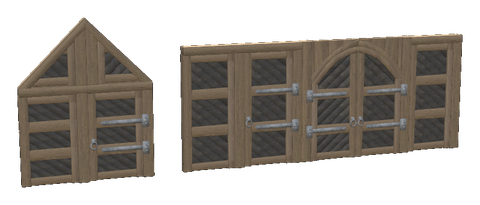

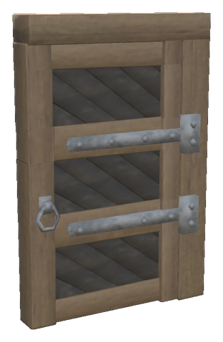 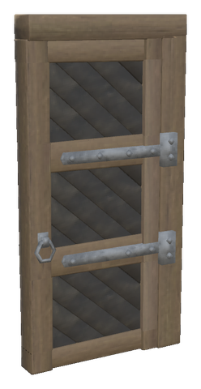 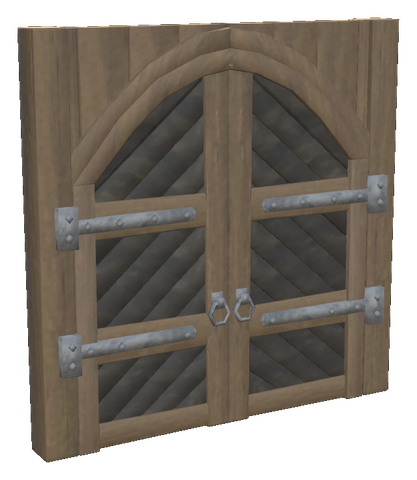 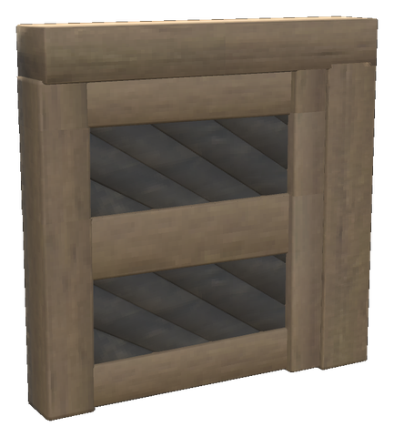 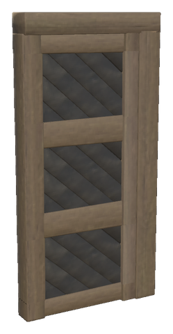 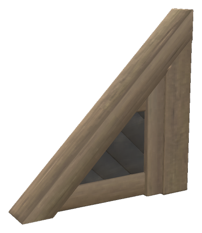

Valheim's Darkwood Gate is half a gate: two of them, the one turned round, make the arched double gate, and there is no darkwood door or wall. These pieces are cut from that gate, so they have its wood, boards, iron and colours:

- **The doors** are the gate's leaf with the arch straightened out: three panels of diagonal boards between the rails, the gate's two hinges and its ring, on the gate's post under a lintel. The panels share the leaf equally; the rails, hinges and ring keep their size. The 3 m door suits the walls of a house, the 4 m door stands beside the gate and the double gate.
- **The walls** are the same post and leaf without iron, fixed, under the same lintel, so the rails of a wall line up with those of a door of the same height. Walls 2 m wide and 1, 2, 3 and 4 m high.
- **The gable walls** are walls cut under a beam that slopes as the 26°, 45° and 67° roofs, rising 1, 2 and 4 m over their 2 m like the vanilla wooden gable walls; turn one round for the other slope.
- **The Darkwood Double Gate** is the vanilla gate twice, as one piece 4 m wide: no more placing two halves against each other. Both leaves open and close together, and close on their own as other gates do.

| Piece | Description | Crafting Station | Requirements |
|-------|-------------|------------------|--------------|
| **Darkwood Door 3 m** | 2 × 3 m, three panels, hinges and ring | Forge | Wood ×12, Iron ×3, Tar ×2 |
| **Darkwood Door 4 m** | 2 × 4 m, as high as the gate | Forge | Wood ×16, Iron ×4, Tar ×2 |
| **Darkwood Double Gate** | Both leaves of the gate under one arch, 4 × 4 m | Forge | Wood ×32, Iron ×8, Tar ×4 |
| **Darkwood Wall 2×1** | One panel | Workbench | Wood ×4, Tar ×1 |
| **Darkwood Wall 2×2** | Two panels | Workbench | Wood ×8, Tar ×1 |
| **Darkwood Wall 2×3** | Three panels, beside the 3 m door | Workbench | Wood ×12, Tar ×2 |
| **Darkwood Wall 2×4** | Three panels, beside the 4 m door | Workbench | Wood ×16, Tar ×2 |
| **Darkwood Gable Wall 26°** | Rises 1 m over 2 m | Workbench | Wood ×2, Tar ×1 |
| **Darkwood Gable Wall 45°** | Rises 2 m over 2 m | Workbench | Wood ×4, Tar ×1 |
| **Darkwood Gable Wall 67°** | Rises 4 m over 2 m | Workbench | Wood ×8, Tar ×1 |

The doors and the double gate are built at the forge for their iron, as the vanilla gate is, and cost what it costs for their size; the walls cost the gate's wood and tar for their area. All are Plains tier (Tar) and sit in the hammer right after the Darkwood Gate. They snap every metre up both sides; the doors and walls also at their top corners, the gables at their foot and up their post.

The pieces are made when the game starts from the gate's own models, so the mod ships no model of them and nothing of the game's. A dedicated server builds only their colliders and snap points. `AssetSource/Preview/render_darkwood.ps1` renders them offline with the same code. The usual `Content` and `Recipes` settings apply to `piece_whitehilt_darkwood_door_3`, `_door_4`, `_gate_double`, `_wall_2x1` to `_wall_2x4` and `_wall_26`, `_wall_45` and `_wall_67`. Not yet tested in the game.

---

## 🔺 WOOD FLOOR TRIANGLES & OCTAGONS

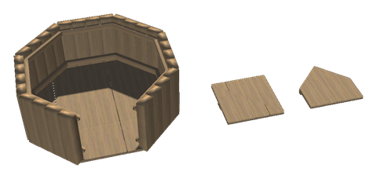

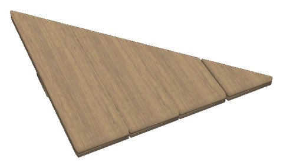 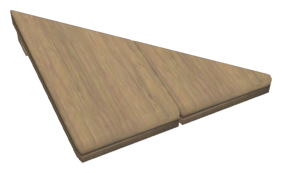 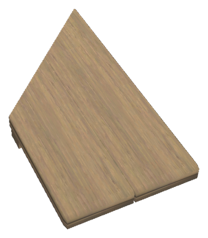 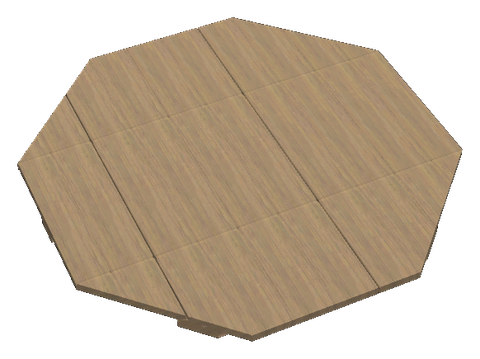 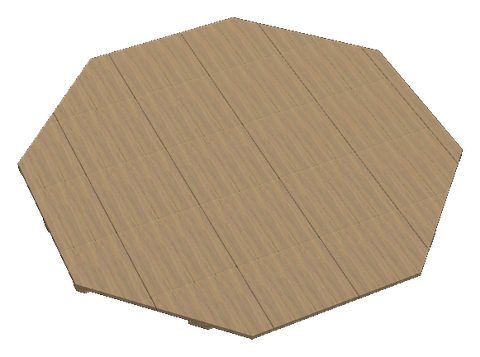 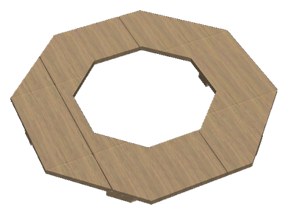 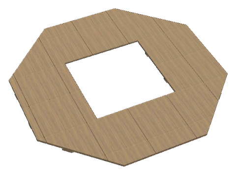

Valheim's wood has gable walls in every pitch (the wall triangles, also upside down), but its floors are only square. These floors are the vanilla 2 × 2 m wood floor sawn to shape: each plank and joist that crosses an edge is cut along it and gets a closed end, so the cut edge looks sawn, not hollow.

| Piece | Description | Crafting Station |
|-------|-------------|------------------|
| **Wood Floor Triangle 2×2** | The 2 × 2 m floor cut corner to corner; two make a square | Workbench |
| **Wood Floor Triangle 1×1** | The 1 × 1 m floor cut corner to corner | Workbench |
| **Wood Floor 2×1, Angled End** | 1 m wide, the end cut at 45°: 2 m on one side, 1 m on the other | Workbench |
| **Wood Floor 2×1, Angled End, Mirrored** | The same the other way round | Workbench |
| **Octagonal Wood Floor 2 m** | Eight 2 m sides, 4.8 m across; a vanilla 2 m wall stands on each side | Workbench |
| **Octagonal Wood Floor 4 m** | Eight 4 m sides, 9.7 m across; two 2 m walls to a side | Workbench |
| **Octagonal Wood Floor 2 m, Stairwell** | The 2 m octagon with an eight-sided opening 2.6 m across in the middle, for the [Spiral Stair](log-house.md#-stairs-ladders-and-railings) or a ladder | Workbench |
| **Octagonal Wood Floor 4 m, Stairwell** | The 4 m octagon with a square opening 4 × 4 m in the middle, on the vanilla floor's grid | Workbench |

- **Cost**: the vanilla wood floor's recipe for the floor's area (it is for 4 m²; the opening is not counted), rounded, at least 1 of each.
- **Snapping**: every corner, as the vanilla floors, and the middle of every side longer than 2.5 m: the long side of the 2×2 triangle (so two triangles meet there) and each side of the 4 m octagon (so a 2 m wall stands on each half). The octagons also snap at their centre, and the stairwells round their opening the same way.
- **Storeys**: put a stairwell floor on the walls of the storey below. In the 2 m tower the **Spiral Stair** stands in the opening: its foot snaps to the centre of the floor below, its head to the centre of the opening, and it rises the 2 m of one wall; a **Loft Ladder** stands against a side of the opening instead. In the 4 m octagon, lay vanilla floors in the opening and leave out what the way up needs: one 2 × 2 m for a **Floor Hatch** or a ladder, two side by side (2 × 4 m) for two vanilla stairs in a row or the **Narrow Stair**, or all four round the Spiral Stair. Railings stand on the opening's edges.
- **Octagon walls**: turn every other wall 45° (two turns of the rotation). The vanilla walls meet at a 45° corner with a small notch on the outside; a wood pole at the corner closes it.
- They keep the vanilla floor's material, strength, wear and category, and sit in the hammer right after the vanilla 1×1 floor. Start tier.

The floors are made when the game starts from the vanilla floor's own model, so the mod ships no model of them. A dedicated server builds only their colliders and snap points. `AssetSource/Preview/render_planking.ps1` renders them offline with the same code. The usual `Content` and `Recipes` settings apply to `piece_whitehilt_wood_floor_triangle`, `_triangle_1x1`, `_angled`, `_angled_mirrored`, `_octagon`, `_octagon_4`, `_octagon_stairwell` and `_octagon_4_stairwell`. Not yet tested in the game.

---

## 🪵 WOOD WALLS 4 M & WINDOW

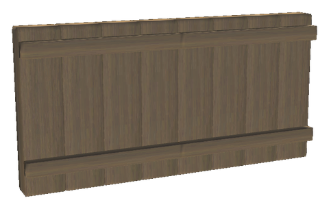 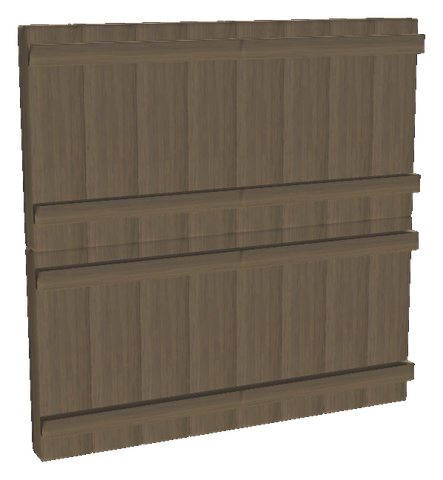 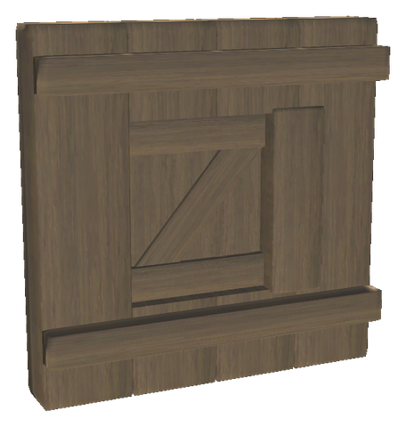

The vanilla wood wall as larger pieces, and with a window sawn into it. Each plank cut for the window gets a closed end, as on the floors above.

| Piece | Description | Crafting Station |
|-------|-------------|------------------|
| **Wood Wall 4×2** | Two vanilla walls side by side as one piece | Workbench |
| **Wood Wall 4×4** | Four vanilla walls as one piece | Workbench |
| **Wood Wall with Window** | A 2 × 2 m wall with a window 1 m wide, 0.5 to 1.5 m above the floor, and the vanilla window's shutter and post | Workbench |

- **Cost**: the 4 m walls cost the vanilla wall's recipe for their area; the window wall costs a vanilla wall and a vanilla window together.
- **Strength**: the vanilla wall's health for each 2 × 2 m, so a 4×4 wall takes as much as the four walls it replaces; it is one piece for support.
- **Snapping**: every 2 m round the edge, corners included, so a 2 m wall snaps to each stretch of a 4 m one.
- They sit in the hammer right after the vanilla wood wall. Start tier. The shutter opens and closes as the vanilla window does.

Made when the game starts from the vanilla wall and window, as the floors are, and rendered offline by the same `render_planking.ps1`. The usual `Content` and `Recipes` settings apply to `piece_whitehilt_woodwall_4x2`, `_4x4` and `_window`. Not yet tested in the game.

### Lattices & braces

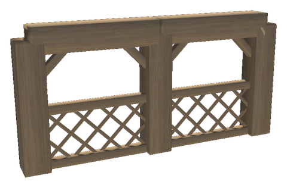

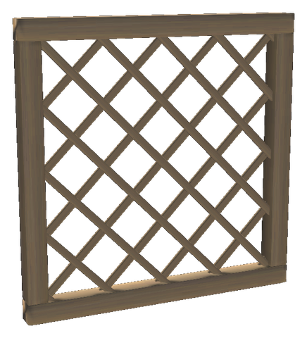 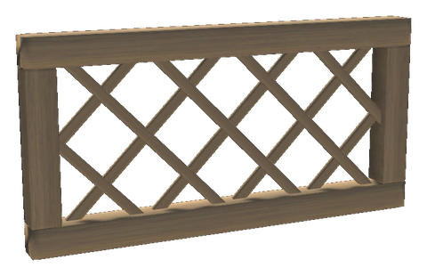 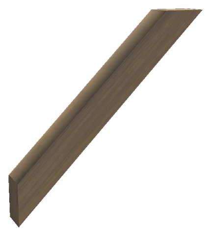 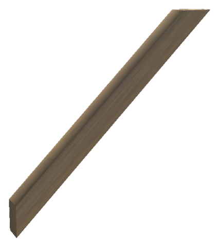 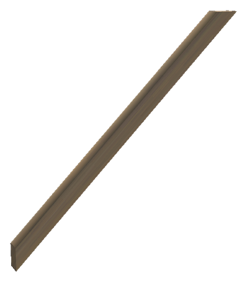

Built of the plank the vanilla walls and floors are made of, stretched to each board as vanilla does, and sawn to fit.

| Piece | Description | Crafting Station |
|-------|-------------|------------------|
| **Wood Lattice 2×2** | A plank frame with slats crossing at 45°: a screen, a gable top or a pergola wall | Workbench |
| **Wood Lattice 2×1** | The same 1 m high, for a balustrade | Workbench |
| **Wood Knee Brace** | A short brace at 45° under a beam or an eave, 0.5 m down and out | Workbench |
| **Wood Brace 1 m** | A brace at 45° between a post and a beam, 1 m down and out | Workbench |
| **Wood Brace 2 m** | The same 2 m down and out, for a hall or a barn | Workbench |

- **Placing a brace**: its corner snaps where a vanilla pole's top meets a beam's end. The length is what shows below the beam and beside the pole (both 0.4 m thick); the brace's ends are sawn at their middle lines, inside them. Turn it 180° for the other side of the post.
- **Lattices** snap at their corners, as the vanilla walls do. The slats' ends sit in the frame.
- **Cost and strength**: a lattice as a vanilla wall of its area; a brace as a wall of 2 m² for every metre it shows. Start tier, in the hammer after the vanilla wood wall.

The usual `Content` and `Recipes` settings apply to `piece_whitehilt_wood_lattice_2x2`, `_2x1` and `piece_whitehilt_wood_brace_05`, `_1` and `_2`. Not yet tested in the game.

### Wide stair, landing & bargeboards

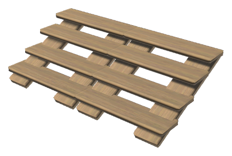 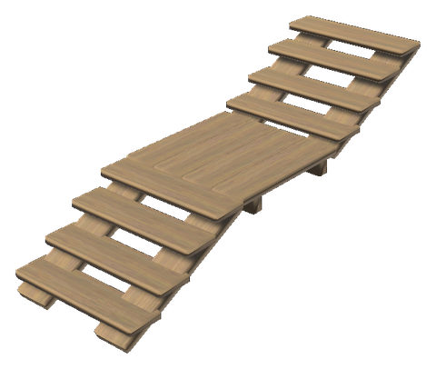 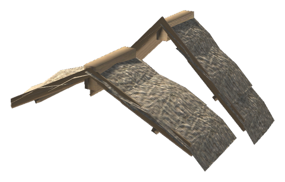

| Piece | Description | Crafting Station |
|-------|-------------|------------------|
| **Wide Wood Stair** | The vanilla wood stair twice side by side: 4 m wide, rising 1 m over 2 m | Workbench |
| **Wood Stair with Landing** | Two flights of the vanilla stair with a 2 × 2 m landing between: up 1 m, 2 m level, up 1 m more, 6 m in all | Workbench |
| **Wood Bargeboard 26°, 45°, 67°** | A plain bargeboard along the gable's edge for one vanilla roof piece, 2 m out | Workbench |
| **Wood Bargeboard 26°, 45°, 67°, Ridge** | The same for the half of a vanilla ridge piece, 1 m out from the ridge end | Workbench |

- **The stairs** are the vanilla stair's own model and colliders, laid out again; they cost and hold as two stairs (the wide one) and three (the one with a landing). The landing's planks lie level with a vanilla floor at the head of the first flight, so a floor, wall or railing snaps to its corners. They sit in the hammer after the vanilla stair.
- **The bargeboards** lie on the roof line as the [dragon gable](roofs.md#dragon-gable)'s boards do and are sawn plumb at both ends. Snap the ridge board to the ridge end of a vanilla (or White Hilt) ridge piece and the next to its foot, one roof piece at a time down to the eave; turn them 180° for the other slope. Made of the vanilla wall's plank; they sit after the vanilla wood wall.
- A **ridge purlin** of its own is left out: the vanilla wood beam and log beam under the ridge are just that.

The usual `Content` and `Recipes` settings apply to `piece_whitehilt_wood_stair_wide`, `_landing` and `piece_whitehilt_wood_bargeboard_26`, `_45`, `_67` and each with `_ridge`. Not yet tested in the game.

---

## Iron Grates

Three additional single-piece panels in the hammer's vanilla building category. Dimensions below are width × height. They repeat unscaled vanilla grate models, preserving the bar thickness and spacing rather than stretching the bars. The 4×4 m panel has seams between four 2×2 m sections.

| Piece | Made from | Requirements |
|-------|-----------|--------------|
| **Iron grate 2×1 m** | Two 1×1 m grates | Iron ×2 |
| **Iron grate 4×4 m** | Four 2×2 m grates | Iron ×8 |
| **Iron grate 4×1 m** | Four 1×1 m grates | Iron ×4 |

Each panel has its own placement collision, icon and snap points every metre along its edges, including corners and midpoints. The original 1×1 and 2×2 m pieces remain unchanged. New panels keep the source grate's strength, support material, build-station rules and wear/destruction effects. The recipes unlock through Iron without extra progression materials.

The usual `Content` and `Recipes` settings apply separately to `piece_whitehilt_iron_grate_2x1`, `piece_whitehilt_iron_grate_4x4` and `piece_whitehilt_iron_grate_4x1`. Live placement, snapping, removal/refunds and multiplayer still require in-game testing.
