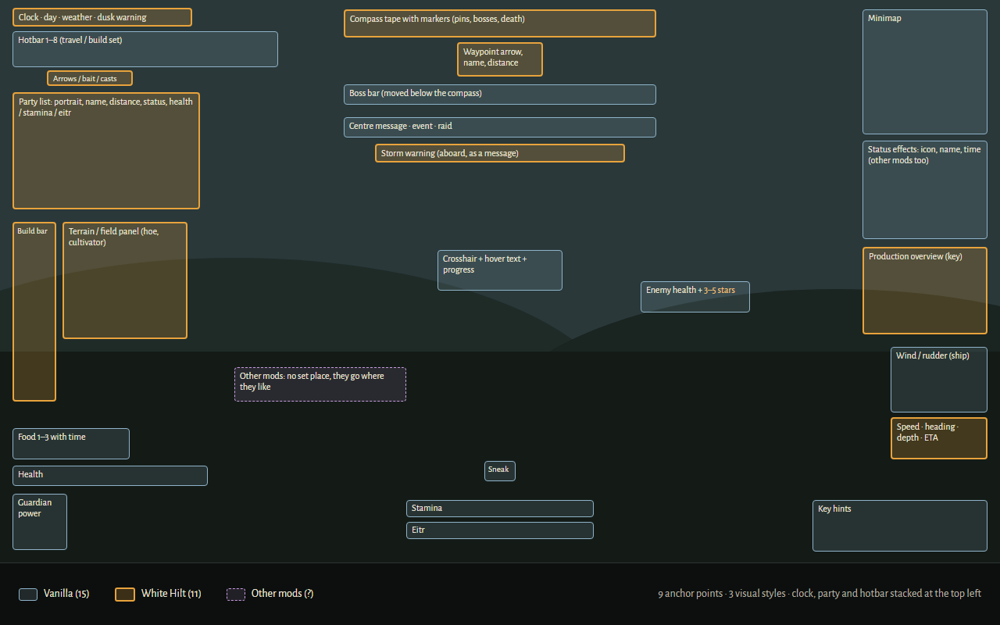
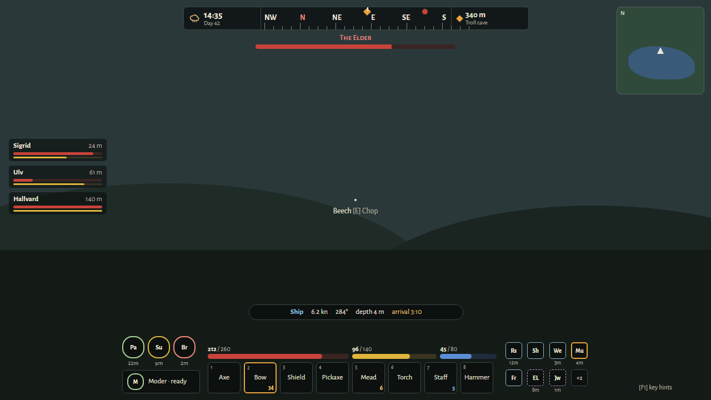
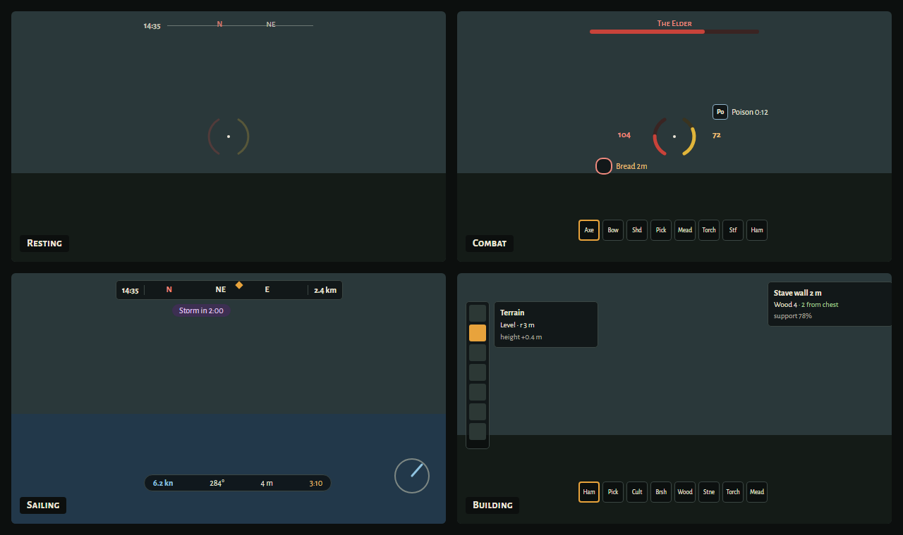

# 🕰️ HUD, clock, party list, sound & floating items

[← Back to the README](../README.MD)

## 🧭 WHITE HILT HUD

The game's own HUD has grown corner by corner: health and food at the lower left, stamina in the middle, status effects under the map, and White Hilt's clock, party list and compass added where there was room. Counted up there are about 25 elements in 9 places and 3 styles, and no place for what other mods add:



The White Hilt HUD gathers everything about yourself in one console at the bottom centre, so the eye goes to one place, and leaves the middle of the screen to the world:



*A concept drawing; in the game the icons are the game's own.*

- **The hotbar** in the middle, with the arrows, bolts, bait or staff casts over the slot that uses them.
- **Health, stamina and eitr** over the hotbar as bars as wide as it, health the widest, each with its number, `212 / 260`; the health number turns red under a quarter. Eitr shows for those who have it, adrenaline while there is some.
- **The food** to the left: each icon on a dark disc with a ring round it that empties as the food runs out, the time left under it, flashing when it can be eaten again. **The guardian power** to the left of the food.
- **Status effects** to the right, four to a row, each with a ring that empties as its time runs out and its time under it: the game's, White Hilt's and other mods' alike. When there are more than fit, the last place goes through the ones left out in turn, with how many they are in its corner. In the inventory, or while you hold the `ShowAll` key, the status effects are a list instead, each with its name and time beside it, so you can see what every icon is. Among them also show **worn gear** you have on, under a fifth of its durability, with how much is left (flashing red when broken), and **your load** from 85 % of what you can carry (red when it is too much).
- **A context strip** over the bars when there is something to say, up to three lines:
  - **Warnings**, for a while, instead of a message in the middle of the screen: night falling (orange) and, aboard a ship with a Navigator's Table, a storm coming (violet).
  - **A raid or other event** while it lasts, in red, instead of the game's event bar.
  - **The piece you are about to build** and what it costs, each amount in the game's own colour for it: red while you have too little, and White Hilt's colour when [nearby chests](chests.md) make up the rest. The game's build panel at the bottom is hidden.
  - **The creature you fight**: the one under the crosshair, for a few seconds after you look away, or else the nearest one hunting you, with its stars, health and what it is weak to, resists and is immune to.
  - **The ship** while you steer it (or ride one sailing its route): speed, heading, depth, wind, held course and time to arrival, instead of under the wind indicator.
  - **Stations near you** (within 20 m) that have stopped, need you soon or are done, the most urgent first, as the [production overview](production.md) has them.

A half dark panel with rounded corners lies behind the console, from the guardian power to the status effects and from under the hotbar to over the bars, so the numbers and icons read against snow and a bright sky; with the quiet screen it fades with the rest. At the top, one band of the same kind lies round the clock, the compass and the waypoint, or, as you choose, the top of the screen darkens and fades out downwards.

The rings of food and of meads and other timed effects turn yellow when less than half is left and red under a fifth, and the red ring pulses. When you are hit, a soft red arc at the edge of the screen shows the side it came from, turning with the camera as it fades, also for hits from behind; this works with the game's HUD too.

The [clock](#-clock) sits at the left end of the [HUD compass](navigation.md#horizontal-hud-compass) and the [waypoint arrow](navigation.md) at the right end; without the compass they go back to their own places. The [party list](#-party-list), with your dog and tamed animals under it, stands at the left, a third of the way down. When the ship controls are under the console, it rises above them.

**Key hints** get their own places: the game's (for fighting, building, the inventory and fishing) at the right of the console, and the build tools' at its left, each made smaller to fit, or over the console when the screen is too narrow. By default (`KeyHints` = `Brief`) they show for a few seconds after you take out a tool or weapon, then fade; `Always` keeps them, `Hidden` shows them only on demand. They always show in the inventory and while you hold the `ShowAll` key.

Other mods that put something of their own on the HUD where the console is get it lifted into a band over the console, stacked if there are several, so nothing covers the bars or the hotbar. Their status effects need nothing; they are in the console with the rest.

### A quiet screen

With `Calm` on, each part of the console shows only while it has something to tell, and fades when it has not: a bar while it is not full, the food while some is half gone or can be eaten again, the status effects for a while after one comes or goes (or while one flashes), and the hotbar and guardian power after a hotbar key, a change of weapon, a drawn bow or a hit. When you rest at full health with full bellies, only the compass is left. Everything shows while the inventory is open, or while you hold the `ShowAll` key.



*A concept drawing of the idea; in the game the bars stay over the hotbar rather than round the crosshair.*

### Settings

The `HUD` section, each player's own:

| Setting | Default | |
|---|---|---|
| `Style` | `WhiteHilt` | `Vanilla` gives the game's own HUD back, with White Hilt's additions where they always were |
| `Scale` | 1 | Size of the bars, food, status effects and context strip; the hotbar keeps the game's size |
| `BottomMargin` | 16 | Pixels from the bottom of the screen to the hotbar |
| `StatusColumns` | 4 | Status effects per row |
| `MaxStatusEffects` | 8 | Most status effects shown; the last place counts the rest |
| `Calm` | off | The quiet screen |
| `CalmSeconds` | 4 | Seconds a part stays after it last changed (status effects three times as long) |
| `CalmOpacity` | 0 | How much of a faded part still shows |
| `KeyHints` | `Brief` | When the key hints show: `Brief`, `Always` or `Hidden` |
| `KeyHintSeconds` | 6 | Seconds `Brief` key hints stay |
| `PanelOpacity` | 0.45 | How dark the rounded panel behind the console is; 0 for none |
| `PanelRadius` | 14 | Corner radius of that panel and of the band behind the top, in pixels |
| `TopBackground` | `Band` | Behind the compass, clock and waypoint: `Band` (one rounded band round them), `Fade` (the top of the screen darkened, fading out downwards) or `None` |
| `TopOpacity` | 0.45 | How dark the band or the darkening at the top is |
| `TopFadeHeight` | 140 | How far down the `Fade` darkening reaches, in pixels |
| `Preset` | `Custom` | A ready-made layout: `Compact` (smaller, quiet screen on), `Standard` or `Large` (for a TV or a large screen). Choosing one sets `Scale`, `BottomMargin`, `StatusColumns`, `MaxStatusEffects`, `Calm`, `KeyHints`, the compass's and party list's `Scale` and the clock's `FontSize`; `Custom` changes nothing |
| `ShowWear` / `WearWarning` | on / 0.2 | Worn gear among the status effects, under this share of its durability |
| `ShowWeight` / `WeightWarning` | on / 0.85 | Your load among the status effects, from this share of what you can carry |
| `ShowTarget` | on | The creature you fight in the strip |
| `ShowProduction` / `ProductionRange` | on / 20 | Stations near you that need you in the strip, within this many metres |
| `DamageDirection` | on | The red arc on the side a hit came from |

`HUD.Keys` → `ToggleStyle` binds a key to switch between the White Hilt HUD and the game's own, and `ShowAll` one that, while held, shows the whole console, the key hints and the status effects as a list with names. Both are unbound at first.

With the White Hilt HUD the label beside the hotbar that tells the travel bar from the build bar is left out, as the food is there; the message when the bar switches still shows. The game's own bars, food and status list are hidden by size, not switched off, so the game and other mods go on updating them, and they come back as they were with `Vanilla`.

### For mod authors

Status effects need nothing: every effect the game shows on its HUD is in the console. For anything else, `BrudvikWhiteHilt.HudLayout.WhiteHiltHud` takes a context line for the strip or an indicator among the status effects. Both are read every frame while the White Hilt HUD shows; return null for nothing.

```csharp
// A line in the strip over the console; higher priority first, at most three lines. The ship read-out is 100.
WhiteHiltHud.RegisterContext("mymod.fishing", 50, () => fishing ? $"Line {depth:0} m · {bites} bites" : null);

// An icon among the status effects, after them.
WhiteHiltHud.RegisterIndicator("mymod.quiver", 0, () => new HudIndicator { Icon = quiverIcon, Name = "Quiver", Text = arrows.ToString() });

WhiteHiltHud.Unregister("mymod.fishing");
```

`WhiteHiltHud.Active` says whether the player sees the White Hilt HUD. A function that throws is logged and removed, so it cannot break the HUD.

---

## 🕰️ CLOCK

The time of day in 24 hours at the upper left above the weapon/tool hotbar, e.g. **Day 42 · 14:37**, with an icon for the weather (sun, moon, clouds, rain, storm, snow, mist or ash). The hotbar moves down only as far as needed to leave room for the clock, and returns to its original position when the clock is hidden. Sunrise is 06:00 and night falls at 18:00, as the game's own day and night. Two in-game hours before dark a warning shows and the clock turns orange until night falls. The clock is hidden in the inventory, in build mode, on the large map, in menus and with the HUD.

The `Clock` section sets whether it shows (`Enabled`), the day number (`ShowDay`), the weather icon (`ShowWeather`), rounding (`RoundMinutes`, 1 = every minute), the warning (`DuskWarningHours`, 0 = off), `FontSize` and `OffsetY`; `Clock.Keys` → `ToggleClock` binds a key to show and hide it. A server can turn the clock off for everyone with `AllowClock`.

With the [White Hilt HUD](#-white-hilt-hud) the clock sits at the left end of the compass instead, and the hotbar is at the bottom. The [horizontal HUD compass](navigation.md#horizontal-hud-compass) and boss bars remain at the top centre and do not move the clock. `OffsetY` controls the clock's distance from the top edge independently of the compass.

---

## 🛡️ PARTY LIST

The other players in a compact list at the upper left, under the hotbar and the arrow count shown under a bow (with the [White Hilt HUD](#-white-hilt-hud), at the left a third of the way down), nearest first. Each row has the player's portrait (the one taken for the [map](navigation.md), or their initial on a disc), their name, how far away they are and up to four status effects, burning, poison and frost first. Under that come health and stamina as bars with numbers, `184/250`, and eitr for players who have it. A row flashes when its player takes a hard hit, the name turns red and the bar pulses under a quarter of the health, and a dead player's row fades until they respawn. The distance is shown only when the player is near or shares their position on the map. The list is hidden in the inventory, in build mode, on the large map, in menus and with the HUD.

Under the players come your companions: your own [dog](dog.md) and every tamed animal following you, nearest first, with name, distance and health; the name turns red under a quarter. They show while they are loaded, near enough for the game to have them.

Each player sends their own health, stamina and eitr to the others, at most twice a second and only when something changed, so the list works however far apart you are.

The `Party` section sets whether it shows (`Enabled`), `ShowStamina`, `ShowEitr`, `ShowDistance`, `ShowEffects`, `ShowSelf` (off), `MaxPlayers` (8), `ShowCompanions` (on), `MaxCompanions` (6) and `Scale`; `Party.Keys` → `ToggleParty` binds a key to show and hide it. A server can turn it off for everyone with `AllowParty`, and then nothing is shared.

---

## 🔊 INDOOR SOUND

Wind, rain, sea and thunder are quieter and muffled under a roof, as heard through walls, so a house is a quiet place to cook and craft in. How much follows how well you are covered: a little under an open roof, most in a closed house (the game's own shelter), and some under the tent of the White Hilt Ship. Under a turf, slate, reed or straw roof (see [Roofs](roofs.md)) it is quieter still (`[Roofs] QuietRoofBonus`). Only the weather's sound changes; fires, cooking, crafting and doors sound as before. Dungeons are left alone.

The `Sound` section sets it: `IndoorSound` (on/off), `IndoorWindVolume` (0.25) and `IndoorRainVolume` (0.3) inside a closed house, `IndoorMuffle` with `MuffleCutoffHz` (1200, lower is more muffled), `FadeSeconds` (1.5) and `ShipTentCounts`.

---

## 🌊 FLOATING ITEMS

Everything dropped floats in water instead of sinking, so a Serpent killed at sea leaves its trophy and meat bobbing on the surface, and nothing is lost when a fight at sea goes overboard. Items that already lay on the sea floor come up when their area loads. The server sets it in the `FloatingItems` section: `Enabled` (on by default) and `SinkingItems`, a comma-separated list of prefab names that still sink (e.g. `Stone,Flint`).
