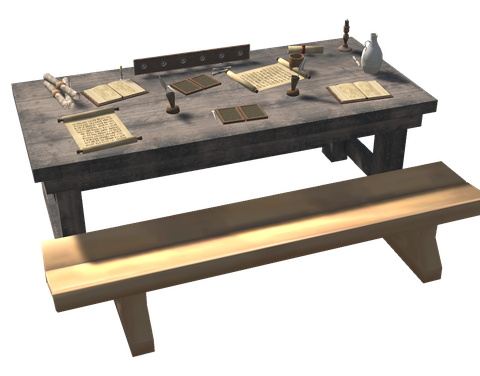

# 📜 School Bench

[← Back to the README](../README.MD)

The **School Bench** (**Skolebenk** in Norwegian) is the map table for what you know. Players write down what they know in it, and others read it and sit on its bench to study. It is a long table set with open scrolls, wax tablets, open books, inkhorns with quills, rolled scrolls and a rack of rune staves, with the game's own bench in front of it. Build it with the hammer under **Furniture**.

| Piece | Station | Requirements |
|---|---|---|
| **School Bench** (`piece_whitehilt_schoolbench`) | Hammer, near Workbench | Fine Wood x10, Wood x10, Leather Scraps x5, Coal x4 (ink), Feathers x2 (quills) |

It is a Black Forest piece (`ProgressionTier.BlackForest`).

## Writing and reading

Use the table to open the bench's window. It lists the skills written in it, with the best level, who wrote it, your own level and how far you can study it. Below come how many materials, crafting stations, texts and map pins the bench holds, how many of them are new to you, and who has written in it.

| Button | What it does |
|---|---|
| **Write what I know** | Writes your skill levels, the materials and crafting stations you know, the runestone texts you have read and your map pins in the bench |
| **Read** | Teaches you what the bench holds that you can learn: materials and crafting stations, and with them the recipes and pieces made from them, the texts, and the map pins you do not have |
| **Shared blueprints** | Opens the [shared blueprints](build-tools.md#shared-blueprints) of this world |

What is written is joined, like the map on a map table: a better level of a skill replaces a lower one, and everything else is added. Someone who knows less never wipes out what someone who knows more wrote. Writing again updates your own entry. What a bench holds belongs to that bench: if it is torn down, it is gone.

**The biome rule.** A material is only taught to a reader who has been to a biome where it is found: dropped by a creature that lives there, picked, chopped or mined from what grows there. One that is made (bronze, a dish, a smelted bar) is taught if the reader can learn everything it is made from. Something found nowhere in the world's spawn and plant lists, such as a boss drop, a trader's ware or a dungeon find, is never taught: you have to find it yourself. A crafting station is taught when you know every material it is built from. This keeps a newcomer from skipping the game's progression by reading. The rule reads the game's own lists, so it also covers other mods' creatures and plants.

## Map pins

Writing also writes **your own map pins**: the marks you set and the places you found, such as the boss stones of the Vegvisirs and Hildir's quests. Deaths, beds, shouts and pings are never written, and neither are pins you got from someone else's map table.

- Writing again **replaces your own pins** in the bench, so a pin you removed leaves the bench too. What others wrote stays.
- Pins of the same kind closer than 5 m (`PinMergeDistance`) count as one.
- Reading gives you the pins you do not have yet. You never get back a pin you wrote yourself, so one you deleted on purpose stays deleted.
- The pins become **your own** pins, so reading a map table later does not remove them.
- The biome rule holds for pins too: you only get pins in biomes you have been to, so a pin cannot show a newcomer the way to a boss.
- The explored map itself is not copied; that stays with the map table.

## Studying

**Sit on the bench** to study. The first time you sit down, you read what is new. Then, every 2 seconds, you study the skill you are furthest behind in and get the same experience whatever the skill. You can reach **half the best level written** for a skill, never more: if the best swordsman wrote Swords 60, you can study Swords up to 30. Skills you already know as well as that are greyed out in the window. A message tells you when there is nothing more to study.

A level needs about half its number to the power 1.5 in experience (level 30 needs 86), so with the default settings, studying a skill from 0 to 30 takes about 17 minutes on the bench. The world's skill gain modifier counts.

## Settings

All are in `[School]` and decided by the server.

| Setting | Default | What it does |
|---|---|---|
| `TeachSkills` | true | Sitting at a School Bench raises your skills |
| `TeachRecipes` | true | Reading teaches materials and crafting stations, and so recipes and pieces |
| `TeachTexts` | true | Reading teaches runestone texts |
| `TeachPins` | true | Reading gives you the map pins others wrote in the bench |
| `MaxPins` | 1000 | Most map pins a bench keeps (50 to 4000) |
| `PinMergeDistance` | 5 | A pin of the same kind closer than this many metres counts as the same (1 to 50) |
| `BiomeRule` | true | A material is only taught to a reader who has been to a biome where it is found, or who can learn everything it is made from |
| `SkillShare` | 0.5 | Share of the best written level of a skill a reader can reach by studying (0.05 to 1) |
| `StudySeconds` | 2 | Seconds between two study steps while you sit |
| `StudyExperience` | 2 | Skill experience one study step gives |
| `MaxWriters` | 50 | Names a bench keeps in its list of writers; the oldest go first |
| `BlueprintRange` | 6 | How near a School Bench you must be to share and fetch blueprints, in metres |

## Multiplayer

What is written lives in the bench's network data, written only by the player or server that owns the bench, after the writer's request. Reading and studying change only your own character, so they run on your own machine. Every player and the server need the mod, and the same version: older versions cannot read a bench with pins.
