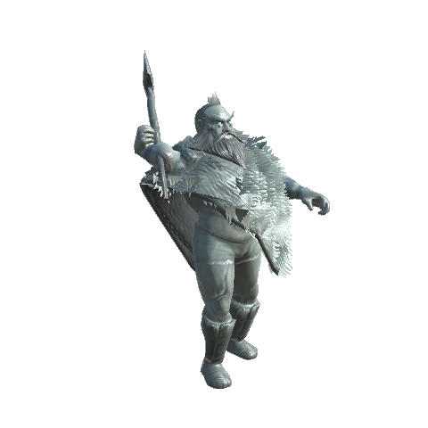

# ⚓ Sea battles & raids

[← Back to the README](../README.MD)

Out on the open sea, a dark longship may come for your ship. It is a **Nail Ship** from Naglfar's fleet, crewed by draugr. You can outrun it, sink it or kill its crew and take it as a prize. Its hold may carry a **Raid Chart** that leads to a draugr harbour on a coast you know.

The Nail Ship needs no new model: it is the vanilla longship with a dark hull, a dim sail and bone-white shields, and the crew are creatures from the game. Later in the game it may come with company: a [fleet](#fleets) led by a flagship with a blood-red sail and a draugr jarl on deck. The fight is built for the [Ship Ballista](ships.md#the-ship-ballista), but a bow and a good crew will do.

The fight is not one-sided. The Nail Ship's bolts and rams knock [holes in your hull](#damage-at-sea), its pitch pots set your [deck alight](#fire-on-deck), its crew throws [grapnels](#grapnels) to haul you alongside, and later in the game it may bring a [fire ship](#fire-ships). Keep wood and resin in the pack and a free hand for the bailing.

You can also take a job at a [trading post](trading-posts.md). Its trader sells an **Escort Contract**: use it at the post, and a [trading ship](#escorts) comes in beside the jetty. When you go aboard your own ship it sets out for the nearest other trading post. The Nail Ships come for the merchant, not for you, and you are paid for seeing it safely to port, more for a longer voyage.

## The Nail Ship

### When and where it comes

A Nail Ship only comes when everything lines up:

- **Nail Ships are on** (`[SeaBattles] Enabled`) and the world has reached the key `RequiredKey` (**Bonemass** is slain, by default).
- You are on a ship at sea: the **ocean** biome, at least **20 m** of water under you (`MinDepth`) and **no land within 100 m** (`MinShoreDistance`).
- You are aboard a ship at sea. The ship can be any ship: a raft, a Karve, a longship, a Drakkar or a White Hilt ship. A Nail Ship is never sent after another Nail Ship.
- No other Nail Ship is hunting and no [Kraken](kraken.md) is about.
- The world's **cooldown** is over: at most one Nail Ship every **45 real minutes** (`CooldownMinutes`) in the whole world. The server forgets the cooldown when it restarts.
- The crew list has a tier for the world. With `RequiredKey` empty and no tier's key set yet, the first tier sails (see [Crew](#the-crew)).

Once a minute, the client that owns the ship asks the server, which checks all of this again and rolls the dice once per ship: **4% per minute** with one player aboard, **2 more percentage points** for each extra player aboard (`ChancePerMinute`, `ChancePerExtraPlayer`; 0 means none come by themselves). The sea is more dangerous in the dark and in bad weather: the chance is multiplied by **1.5** at night (`ChanceAtNight`), **1.5** in a storm (`ChanceInStorm`) and **1.5** in fog or mist (`ChanceInFog`), so a foggy night more than doubles it. The cooldown starts only when a Nail Ship is sent, and the order to raise it goes to whichever machine owns your ship.

When one comes, a **horn** sounds near your ship and everyone aboard is told where it is, for example *Sails on the horizon, off the starboard bow! A Nail Ship comes for you.* (dead ahead, off the port or starboard bow, to port or starboard, off a quarter, or astern). The place is pinned on your map as *Nail Ship sighted* for **90 seconds** (`SightingPinSeconds`, 0 for no pin). The Nail Ship appears **180 m** away (`SpawnDistance`) in the quarter ahead of you, in deep water, facing your ship. It has no helmsman and no player aboard: its crew sails it.

A [Lookout](navigation.md#what-exploration-gives) shows it as a sea monster. It never shows on a [Harbour Anchor](ships.md)'s map, it cannot be pushed, moored or taken apart with the Hammer, and the Kraken does not rise beside it.

### The crew

The crew depends on how far the world has come. Each tier belongs to a global key, and the last key that is set wins (`CrewTiers`):

| After | Crew |
|---|---|
| Bonemass | 3 Draugr and 2 Draugr Archers |
| Moder | 3 Draugr, 2 Draugr Archers and 1 Draugr Elite |
| Yagluth | 3 Fulings, 2 Fuling Archers and 1 Fuling Brute |
| The Queen | 4 Draugr Elites, 3 Draugr Archers and 1 Fuling Brute, all at least one star |
| Fader | 4 Charred Warriors, 2 Charred Marksmen and 1 Charred Warlock, all at least one star |

Each extra player aboard your ship adds **1 more warrior** (`CrewPerExtraPlayer`). Players counted are those within 60 m of your ship. A creature with *Ranged*, *Archer* or *Mage* in its prefab name shoots from its post; the others fight in melee. The crew are ordinary creatures of their kind, with stars rolled as for any other spawn, and they hunt players. From the Queen on, every crew member is at least level 2, one star (`CrewLevels`).

The Nail Ship has **1200 health** (`HullHealth`), and more as the world goes on (`HullTiers`): ×1.25 after Moder (1500), ×1.5 after Yagluth (1800), ×2 after the Queen (2400) and ×2.5 after Fader (3000). It takes pierce damage in full, so arrows and ballista bolts hurt it, is weak to fire and shrugs off chop, pickaxe, poison and spirit damage. It is not indestructible.

An older config file that still has the crew list of earlier versions (which ended at Yagluth) is given the new one when the game starts; a list you have changed is kept.

## The fight

1. **Approach.** It sails at full sail with the wind straight behind it (`Tailwind`), aiming ahead of where you are going. It steers round shallows and rocks; where nothing ahead is clear it turns about at slow speed, and where nothing at all is clear it backs off.
2. **Broadside.** Within about 38 m (1.5 × `BroadsideDistance`) it turns and lies alongside, **25 m** off one side of your ship. It takes the side it comes from, unless fewer of your crew stand at the other rail. It aims a little ahead of a moving ship so it comes up level with it, and then matches your speed: full sail when it falls behind, half sail when level, no sail when it has run past. Its archers shoot, and its warriors wait on its deck. It sails at full sail again whenever you are more than 50 m away.
3. **Boarding.** After **40 seconds** alongside (`BroadsideSeconds`, 0 means never) it closes in until the gap is about 4 m. Then, every **4 seconds** (`BoardIntervalSeconds`), the next of its warriors leaps across onto your deck, in number order, once he is within **6 m** (`BoardDistance`) of it. From Yagluth on, **two** leap at a time (`LeapTiers`). Once he is aboard he is an ordinary creature on your ship. A ship with only archers left never boards.
4. **Flee.** When only **25%** of its crew is left (`FleeCrewShare`) or **20%** of its hull (`FleeHullShare`), it turns and runs at full sail for good, and everyone within 100 m is told *The Nail Ship turns and runs.* A fleeing ship gives no prize unless you catch it and kill the crew.

If you get more than **75 m** away (3 × `BroadsideDistance`) while it lies alongside or boards, it goes back to the approach at full sail, and its 40 seconds start over when it is alongside again. A ship that is kept from you by land or shallows for **45 seconds** (`StuckSeconds`, 0 for never) without getting any nearer gives up: *The Nail Ship cannot reach you and turns away.* It then flees like a beaten ship. Hiding in a shallow bay is a way out, but not a way to shoot a stranded raider to pieces.

The time it has spent in each step is kept in world time in the ship's data, so the boarding does not start over when another player's machine takes over the ship.

While nobody is on a Nail Ship's deck, its crew keep to their posts. Archers shoot from where they stand and warriors wait for their turn. If you leap aboard, the warriors fight you, but one who walks off the deck is put back.

**The crew mends its ship.** Every **10 seconds** (`CrewRepairSeconds`, 0 for never), while a crew member is still aboard, the crew puts out one fire on its deck or, if none burns, patches one hole. A patch closes the hole but does not give back hull health. Sweep the deck, or keep the fire and the bolts coming faster than they can mend.

The helm of a Nail Ship stays shut (*The dead still hold the helm.*) and so does its hold (*The crew guards the hold.*) while its crew lives. You cannot use the hold for crafting either.

A Nail Ship **gives up** when no player is within **300 m** (`DespawnRange`) for **60 seconds** (`DespawnSeconds`), or when the ship it hunts is gone for as long. Then it and its crew sail out of sight. A player standing on it keeps it.

### No outrunning them at first

When Nail Ships come for a ship, its speed is **held a little below theirs** for the first **60 seconds** (`PursuitShockSeconds`), so even a White Hilt ship cannot simply sail away: the cap is **85%** of the fastest hunter's speed (`PursuitSpeedFactor`), never below **4 m/s** (`PursuitFloorSpeed`), and the ship is braked gently down to it, not stopped. Everyone aboard sees *The Nail Ships close in. The wind fails your sail.*, and the helm shows *Held by the Nail Ships*.

After that you may run, unless **living raiders stand on your deck**: then the ship stays held until they are dead or gone (*The raiders aboard drag at your ship.*). When the hold lifts you are told *You shake off the ambush. Now you can run.* A chase ends 30 seconds after the last hunter, so the next attack holds you again. Off with `PursuitEnabled`.

### They do not harm their own

A Nail Ship takes no damage from its own side: not from its crew's blows (a Fuling Brute's swing no longer splinters its own deck), not from a Nail ballista's bolts, and not when two Nail Ships of a fleet run into each other. Your blows, bolts, rams and collisions hurt them as before.

### Boarding leap

On the deck of any ship, **look at another ship within 10 m** (`BoardingLeapRange`) and press **Use**: *Leap aboard* shows under the crosshair. You land on the deck point nearest to where you looked and keep the other ship's speed, so you do not slide off. There is a one-second wait between leaps.

It works between any two ships, also to help a friend, and onto a Nail Ship. Use goes to the helm, the hold or a door first if you look at one of them. The leap works while `[SeaBattles] Enabled` is on.

## The prize

When the last of the crew is dead, the Nail Ship is yours:

- It stops, and everyone within 100 m sees *The crew is dead. The Nail Ship is yours, but its nails will not hold for long.*
- The helm and the hold open. Take the helm and sail it, or empty the hold.
- The hull shows *Prize: sinks in N min*. After **10 minutes** (`PrizeMinutes`, world time) the nails give way and it sinks. The hold drops as a **cargo crate**.
- A prize at sea is not kept in the world. If everyone sails far away, it is gone with its hold.

The hold holds **4 draws** from a loot list (`Loot`, `LootRolls`): by default coins, iron, chain, withered bone, amber, amber pearls, rubies, Ship Bolts and a draugr trophy. Later in the world the hold carries the goods of the latest biome instead (`LootTiers`): silver, obsidian, wolf pelts and freeze glands after Moder; black metal, linen thread, tar and needles after Yagluth; black marble, eitr, Yggdrasil wood, carapace and sap after the Queen; flametal, charred bones, charred skulls and molten cores after Fader; each with more coins, rubies and Ship Bolts. By chance (**35%**, `RaidChartChance`) it also holds a **Raid Chart**.

If you sink the hull instead, the deed counts too and the hold drops as a cargo crate, but the crew goes down with the ship and leaves no loot.

## Fleets

Later in the game a Nail Ship does not always come alone. A **fleet** is two or three Nail Ships that sail up in a wedge behind a **flagship**, break formation when the fight starts and come at your ship from both sides. The flagship is led by a **draugr jarl**. When the jarl falls or the flagship is taken or sunk, the rest of the fleet turns and runs.

### When fleets come

A fleet is a Nail Ship encounter that the server has made bigger, so everything under [When and where it comes](#when-and-where-it-comes) still holds: the same conditions, the same dice, and one fleet counts as one encounter for the 45-minute cooldown. When the server sends an encounter, it rolls once more for the size, from the tiers in `[SeaBattles.Fleets] FleetTiers`. By default:

| After | Chance of a fleet | Ships |
|---|---|---|
| Moder | 35% | 2 |
| Yagluth | 50% | 3 |
| The Queen | 65% | 3 |
| Fader | 80% | 3 |

The last key that is set decides. If the roll fails, or no key is set, a lone Nail Ship comes as before. With `Enabled` off, only lone ships come. An older config file that still has the two tiers of earlier versions is given the new four when the game starts.

The horn sounds and everyone aboard is told where the fleet is, for example *A fleet on the horizon, dead ahead! The Nail Ships come in force.* The flagship appears at the usual spawn distance, and the escorts at their places in the wedge behind it, in deep water: an escort with no deep water at its place is left out, so a fleet can be a ship smaller than the server chose. Every ship has the crew a lone Nail Ship has, including the extra warriors for the players aboard your ship, and the escorts are plain Nail Ships.

### The wedge

While the fleet closes in, the escorts keep their places behind the flagship:

- The first escort lies back and to port, the second back and to starboard, each **0.7 times** `FormationSpacing` (30 m by default, so 21 m) back and to the side.
- An escort sails at full sail when it is behind its place and more than the spacing away, at half sail when it is near, and not at all when it is ahead of its place. Within 10 m of its place it follows the flagship's heading.
- The flagship sails at half sail instead of full while an escort is more than the spacing out of its place, so the wedge can keep up.

The wedge breaks when the flagship is within **80 m** (`FormationBreak`) of your ship, or when it no longer approaches (it lies alongside or flees). Then each ship fights on its own, as a lone Nail Ship does (broadside, boarding, fleeing when its own crew or hull runs low), but the escorts take different places:

- the **first escort** lies alongside on the side of your ship that the flagship does *not* lie on, at the usual **25 m**;
- the **second escort** lies on the same side as the flagship, but **1.6 times** as far out (`EscortSpread`), 40 m by default, so two ships do not lie on top of each other.

An escort holds the wedge only while the flagship is loaded on the machine that steers the escort; otherwise it fights on its own from the start.

### The flagship

The **Nail Flagship** is a Nail Ship with:

- a **blood-red sail**;
- a stronger hull: **2000 health** (`FlagshipHullHealth`), against 1200, and as much more as a Nail Ship gets from `HullTiers`;
- a bigger crew: the tier's crew, **2 more warriors** (`FlagshipExtraCrew`) of the tier's first warrior kind, and the jarl. Every member is at least **level 2** (one star, `FlagshipCrewLevel`);
- the **ballista on its bow** always, whatever `NailBallistaKey` says (`NailBallista` still switches it off);
- a fuller hold: **4 more draws** from the loot list (`FlagshipLootRolls`, 8 in all by default) and always a **Raid Chart** (`FlagshipRaidChart`).

With the default crew list, a flagship after Moder carries 3 Draugr, 2 Draugr Archers, 1 Draugr Elite, 2 more Draugr and the jarl. It is otherwise a Nail Ship: its helm and hold stay shut while its crew lives, it becomes a prize when the crew is dead, and the Lookout and the hull show it as a *Nail Flagship*.

### The draugr jarl

The jarl is a huge undead viking with a fur cloak, glowing eyes and a great axe, about **2.3 m** tall (2.7 m at level 3, as he grows 8% per star). He is a creature of his own, with his own model and animations; see [Monsters](monsters.md#draugr-jarl). He only appears here: **on the deck of a flagship**, as part of its crew.

- He keeps to the post nearest the mast like the other warriors, fights whoever comes aboard and leaps across with his men, **last of all**. Once he fights he does not flee.
- He grows with the world (`JarlLevels`): **level 3** (two stars, about **1800 health**) after Moder, **4** after Yagluth, **5** after the Queen and **6** (five stars, about **3600 health**) after Fader. His two slash attacks hit 2 to 3.5 times as hard as the numbers in [Monsters](monsters.md#draugr-jarl), before pressure bonuses. A fleet an admin sends before Moder has a level 3 jarl.
- He resists pierce, so arrows and bolts hurt him less; he is weak to fire and spirit and immune to poison.
- He always drops his trophy, the **Draugr Jarl Trophy**.

### Morale

The escorts turn and run, at full sail and for good, when:

- **the jarl is slain** (`FleeWhenJarlFalls`): everyone within 100 m of the flagship sees *The jarl has fallen!*; or
- **the flagship is taken or sunk**, or gives up and sails out of sight (`FleeWhenFlagshipFalls`).

A running escort says *The fleet breaks and runs!* A flagship that only flees because its own crew or hull is low does not break the morale: the escorts leave the wedge and fight on. An escort that a [grapnel rope](ships.md#the-ship-ballista) binds still cannot run: it keeps alongside and sends its warriors across.

### The jarl's horn

Kill the jarl quickly. When a flagship has fought alongside for **3 minutes** (`ReinforceMinutes`, 0 for never) and its jarl still lives, he blows his horn: it is heard far over the sea, everyone within 100 m of the flagship sees *The jarl blows his horn! Another Nail Ship answers.*, and one more Nail Ship appears about 145 m from your ship, from any side, with the flagship's crew tier. It joins the fleet: it lies alongside on the first escort's side, but as far out as the second escort, and it runs with the rest when the morale breaks. The horn sounds once per fleet.

Breaking a fleet is a [saga](saga.md) deed, **A Nail fleet was broken**, given once when the flagship is taken or sunk, besides the deed for the ship itself (see [Saga deeds](#saga-deeds)).

## The Ship Ballista

The [Ship Ballista](ships.md#the-ship-ballista) is a ship upgrade for the White Hilt Ship and Skidbladnir. Man it, aim with the camera and shoot **Ship Bolts** with the attack button. The bolts hurt a Nail Ship's hull and crew, and also serpents and the Kraken, and a heavy bolt knocks a [hole](#damage-at-sea) in a hull. Two other kinds of ammunition fit it: the **Chain Shot** tears a ship's sail, and the **Grapnel Bolt** binds a ship to yours so your crew can board; the secondary attack switches between them. The recipes, the ammunition and the settings are on the [Ships](ships.md) page.

## Damage at sea

During a sea battle any ship can be holed and flooded: yours, a friend's, a raft, a Karve, and the Nail Ship itself. It is on by default (`[SeaBattles.Damage] Enabled`).

### Holes

A hole is knocked in the hull when:

- **A heavy hit lands in a battle.** One blow whose blunt, pierce, slash and chop damage add up to at least **60** (`HoleMinDamage`), counted before the hull's resistances. A Ship Bolt (80 by default) does; an ordinary arrow usually does not. A ship is in a battle when it is a Nail Ship, or lies within **200 m** (`BattleRange`) of a Nail Ship that is still a threat (a prize ship does not count).
- **A ram hits.** A [Ram Prow](ships.md#the-ram-prow) always makes a hole, whatever damage it does.

Fire, poison, drowning, water and the Ashlands ocean do not make holes. With no Nail Ship about, only a ram does.

The hole is made at the waterline, on the side that was hit, and shows as splintered planks low on the hull with water spraying in. Everyone aboard sees *The hull is holed!* A new hole within 1 m of an old one is the same hole, and a ship has at most **6** at once (`MaxHoles`). The White Hilt ships are indestructible, but they are holed like any other ship.

### Flooding

Every open hole lets in **1%** of a full ship per second (`FloodPerHole`): at the defaults one hole fills a dry ship in about 100 seconds and six in about 17. The more water, the worse the ship sails:

- It lies lower, up to **0.8 m** when full (`SinkDepth`), and the water shows as a pale sheet growing over the deck.
- It sails slower: a full ship loses **60%** of its sail force (`FloodSpeedLoss`), in proportion to the water. This also holds for a Nail Ship, and it stacks with a torn sail (see [Chain Shot](ships.md#the-ship-ballista)).
- The read-out at the helm and the line under the crosshair aboard show *Water in the hull: n%*.
- A full ship that is not indestructible takes **25** damage per second (`FloodDamagePerSecond`) until it breaks up. Everyone aboard sees *She is going down!* and the hold drops as a cargo crate. A Nail Ship you hole sinks like this too, and as its hull falls it turns to flee sooner.
- **White Hilt ships never sink.** They flood and slow down, but lose no health.
- Once every hole is patched the water drains by itself, **0.5%** of a full ship per second (`DrainPerSecond`), so a full ship takes about 200 seconds.

A ship that was left alone for a long time does not flood all at once when it loads: a flood step covers at most one minute.

### Patching and bailing

- **Patch:** look at the hole, or at the water spraying in, and press **Use**: *Patch (2 wood, 1 resin)*. The wood and resin come from your inventory (`PatchWood`, `PatchResin`); without them you see *You need wood and resin to patch it*. The hole is gone, and a hull that is not indestructible mends **10%** of its health (`PatchRepair`). You can patch from the deck, or from a boat alongside. Use goes to the helm, a hold or a door first if you look at one of them.
- **Bail:** on a flooded ship, press **Shift + Use** (the alternative use key) anywhere aboard: *Bail water*. Each bail takes **4%** of a full ship out (`BailAmount`) and costs **8** stamina (`BailStamina`), no faster than every **0.6** seconds (`BailSeconds`). Without enough stamina the stamina bar flashes and you are told you are too tired.

The crew of a Nail Ship never patches or bails.

## Fire on deck

A [Pitch Pot](#the-pitch-pot) that lands on a deck sets it alight, wherever it comes from: the Nail Ship's crew throw them at you, and you can throw them at the Nail Ship.

- **Where:** the fire starts at the deck point nearest to where the pot lands, if that is within 2.5 m. A pot that falls in the sea, hits the hull's side below the rail or lands on dry ground makes no fire (on land it only does its fire damage). Everyone aboard sees *Fire on deck!* when the first fire starts. A pot thrown by a Nail Ship's own crew that lands on the Nail Ship does nothing.
- **How long:** a fire burns **30** seconds (`DeckFireSeconds`), and goes out twice as fast in rain. A pot that lands within 1 m of a fire feeds it: it burns for the full time again, and no new fire is made. A ship has at most **6** fires (`MaxDeckFires`).
- **What it burns:** anyone aboard who stands within **1.5 m** of a fire (`DeckFireRadius`) takes **8** fire damage per second (`DeckFireDamage`). Each fire also burns the hull for **4** fire damage per second (`DeckFireHullDamage`), so a ship left burning breaks up in the end. White Hilt ships take no hull damage, but players aboard still burn.
- **Stamp it out:** look at the fire and press **Use**: *Fire on deck, Stamp out*. It costs **10** stamina (`StampStamina`) and puts that fire out. A hole you look at takes the key first.

## The Nail Ship fights back

A Nail Ship has more weapons than its crew's arrows and swords:

- **Pitch pots.** While it lies alongside or closes in to board, a living crew member still aboard throws a pot at your deck every **12** seconds (`PitchPotSeconds`), within **35 m** (`PitchPotRange`). It aims beside one of the players on your deck, or anywhere on it if nobody stands there, and leads a moving ship. The pot belongs to the thrower, so it does not hurt his own side. `PitchPots` switches it off.
- **A ballista.** Once the world has reached `NailBallistaKey` (**Moder** is slain, `defeated_dragon`, by default; empty for always) the Nail Ship carries a ballista on its bow (`NailBallista` switches it off entirely). It turns towards your ship, and while the Nail Ship approaches, lies alongside or closes in to board it shoots a Ship Bolt at your hull at the waterline every **10** seconds (`NailBallistaSeconds`), within **60 m** (`NailBallistaRange`), off by up to **3** degrees (`NailBallistaAccuracy`). The bolt has the damage of a Ship Bolt (`[Ships.Ballista] Damage`, 80), so every hit that lands knocks a [hole](#holes) in your hull. Nobody owns the bolt, so it hurts whatever it hits. A [flagship](#the-flagship) always carries the ballista, whatever `NailBallistaKey` says.

If the Nail Ship is bound to your ship by a [grapnel rope](ships.md#the-ship-ballista), it cannot flee: it keeps alongside and sends its warriors across.

### Grapnels

While it lies alongside or closes in to board, a living crew member throws a **grapnel** at your rail every **40 seconds** (`GrapnelSeconds`), when the two rails are within **30 m** (`GrapnelRange`). Everyone aboard both ships sees *A grapnel bites into the rail! Cut the rope, or they will haul you alongside.* The rope is the same as a Grapnel Bolt's: it pulls the two ships together (`[Ships.Ballista] GrappleLength`, `GrapplePull`), snaps when they are pulled more than 60 m apart and frays after 90 seconds. A ship that is bound throws no other rope, and a bound Nail Ship cannot flee or give up.

**Cut it** at either end: look at the end of the rope on your own rail and press **Use** (*Grapnel rope, Cut the rope*). Off with `Grapnels`; `GrapnelKey` sets a global key from which they are thrown (empty: always).

### The ram

From Moder on (`RamKey`, `defeated_dragon`), **3 in 10** Nail Ships (`RamChance`) carry an iron-shod **ram** on the bow: the same stem as the [Ram Prow](ships.md#the-ram-prow). A ship that lies still or sails slower than **2.5 m/s** (`RamTargetSpeed`) and is **15 to 60 m** away (`RamRange`) is charged: *The Nail Ship turns to ram you!* It sails at full sail straight at you, and its bow knocks a hole in your hull and hurts it as a Ram Prow does (`[Ships.Ram]` settings). The charge ends when it strikes, after 15 seconds, or when you get up speed, and it then comes alongside again. It charges again after **45 seconds** (`RamSeconds`). A ram never strikes another Nail Ship. Keep way on the ship and the ram has nothing to aim at.

### Fire ships

From Yagluth on (`FireShipKey`, `defeated_goblinking`), **1 in 4** encounters (`FireShipChance`), lone ships, fleets and escort waves alike, bring a **Fire Ship** along: a Nail Ship with no crew, its deck ablaze, that comes from its own bearing and sails at full sail straight for you. When it is within 120 m you are warned: *A fire ship comes at you! Sink it before it strikes.* If it comes alongside it strikes: the blow burns your hull, and it lights **3** fires (`FireShipFires`) on your deck one after the other before it goes down (*The fire ship strikes! The deck is ablaze.*). See [Fire on deck](#fire-on-deck).

It has only **0.4** of a Nail Ship's hull (`FireShipHullShare`), so a few bolts sink it; it carries no ballista, no hold and no deed. Left alone it burns down and sinks by itself after **90 seconds** (`FireShipSeconds`). Outrun it, or sink it before it reaches you.

## The Pitch Pot

A clay pot of hot pine tar with a burning rag. It is thrown like a bomb: equip it and press the attack button. It does **20** fire damage where it hits (`PitchPotDamage`) and sets a deck alight. It is made at the Workbench and belongs to the Swamp tier. It can be made only while `[SeaBattles] Enabled` is on.

| Item | Effect | Crafting Station | Requirements |
|------|--------|------------------|--------------|
| **Pitch Pot** (`WhiteHiltPitchPot`) | Sets a deck alight, see [Fire on deck](#fire-on-deck). Made `PitchPotsPerCraft` (2) at a time | Workbench | Pine Tar ×1, Resin ×2, Leather Scraps ×1 |

## Raids

A **Raid Chart** has no recipe and no trader: it is found in a Nail Ship's hold. Use it from your inventory to mark a **draugr harbour** on a coast.

### The chart

- The harbour lies **400 to 1500 m** from you (`MinDistance`, `MaxDistance`), on land you have **explored**, near water. The biomes are the ones in `[Treasure] AllowedBiomes`: the Meadows to the Plains by default.
- The server checks the place. It must be dry, away from other harbours (`[Treasure] MinTreasureDistance`, 150 m), from anything players have built (`[Treasure] MinBaseDistance`, 60 m), from other places and from trees and rocks at the chest. There must be **deep water** for a ship within 80 m of it (`ShipSearchRadius`).
- The harbour is marked on your map as a **Draugr harbour** pin and you see *A draugr harbour is marked on your map.* If you wear the Pathfinder's Ruby Amulet, its target arrow points the way.
- The chart is used up only when a harbour was made. With no known coast it says *No coast on this chart is known to you.* With `MaxActive` harbours waiting (6 by default; a sacked one does not count) it says *Every draugr harbour is manned already. Sack one first.* In both cases you keep the chart.

### The harbour

- **A moored Nail Ship** lies in the water off the shore, along the coast, crewed as at sea and with a hold of its own. It does not sail. Kill its crew and it becomes a prize like any other: you can sail it away, and it sinks after the prize minutes.
- **Guards** stand in a ring round the hoard, **12 m** from it (`GuardRadius`): by default 4 Draugr, 2 Draugr Archers and 1 Draugr Elite (`Guards`). A guard that strays more than **8 m** from its post (`GuardHoldRadius`) turns back, unless a player stands within that distance of the post.
- **The hoard** is a chest with 8 draws from its own loot list (`Loot`, `LootRolls` in `[SeaBattles.Raids]`: the ship's list plus a Gift of Odin). It stays shut while a guard lives near it (*The guards still live.*). It cannot be broken open or taken apart.
- The harbour is made in the saved world, so it is there when you arrive, also on a dedicated server where nobody was near, and it stays after you leave or the world restarts.

When the hoard is opened with no guard alive, the harbour is **sacked**. It is a [saga](saga.md) deed, once. The chest goes away once it is empty. The ship and what is left of its crew stay.

## Escorts

A merchant's trading ship sails from one trading post to the nearest other one, and you guard it against the Nail Ships. It sails on its own and its helm is shut, so the work is yours: beat the raiders back, kill the ones who land on its deck and patch its holes. If it reaches port with its cargo, every player near it is paid.

| Item | Effect | Where | Price |
|------|--------|-------|-------|
| **Escort Contract** (`WhiteHilt_EscortContract`) | Use it at a trading post to call a trading ship there | The trader of every [trading post](trading-posts.md), once the world has reached `[SeaBattles] RequiredKey` (**Bonemass** is slain, by default) | 300 coins (`ContractPrice`) |

Nobody sells it when `[SeaBattles.Escorts] Enabled` or `[SeaBattles] Enabled` is off. With the trading posts off (`[TradingPosts] Enabled`), Haldor sells it as before and it is used aboard your ship at open sea, as described under *At sea* below.

### The contract

Use the contract from your inventory at a trading post, under its dome. The server checks the call and either finds a port or says no:

- **Where you are:** you must be under a trading post's dome. Otherwise you see *Use the contract at a trading post, under its dome.*
- **A port:** the port is **the nearest other trading post**, however far, 30 m off the end of its jetty. If the world has no other post you see *There is no other trading post to sail to.*
- **A sea route:** the server plans the way from your post to the port over the world's ground, with the same route finder as the [Navigator's Table](ships.md), so the merchant sails round islands and into bays instead of straight at them. It takes a few seconds for a long way. If no sea route leads there (a post on a lake or a closed bay) you see *No sea route leads from here to the nearest other trading post.* and keep your contract. Where the jetty head lies in shallows the port is moved to the nearest deep water, and the pay follows the length of the **route**, not the straight line.
- **Busy or too soon** and **Off:** as below.

The trading ship comes in beside the post's jetty, on the side away from your own ship (or the other side if that water is too shallow or taken), bow to the sea, and waits there; the contract is used up, the port is marked on your map, and you see *A trading ship comes in to the post. Go aboard your own ship to set out; its port is marked on your map.* Look at it to see *Waiting for you to go aboard your ship*. It waits without waves and without the abandon timer until you stand on your own ship within **150 m** of it (`StartRange`); then it casts off, everyone near sees *The merchant casts off. Guard it to port!*, and the escort below begins. If you have not come aboard within **10 minutes** (`WaitSeconds`), it sails off and you get the contract back: *Nobody came, so the merchant sailed off. You get the contract back.* It stays at the post while you fetch your ship, however far you go: the trading ship is kept in the world, and the server ends what nobody comes back to. A merchant that waited too long expires and gives the contract back; one left alone at sea is abandoned; and one whose escort is over is taken away after five minutes.

**At sea** (trading posts off, or an admin's `escort`): use the contract while you are aboard a ship at sea, and the server checks:

- **A port:** the server looks for a straight line of deep water, **1200 to 2000 m** long (`MinDistance`, `MaxDistance`), ahead of your ship (up to 70 degrees to each side of its heading), where every point on the line, every 50 m, has at least **6 m** of water (`MinDepth`). It tries the farthest port first and works inwards in steps of 200 m. If there is no such line you see *No clear deep-water passage from here. Sail further out.*
- **Where you are:** you must be aboard an ordinary ship, within 60 m of it, in the **ocean** biome. A Nail Ship or a trading ship will not do. Otherwise you see *You must be aboard your own ship at open sea.*
- **Busy or too soon:** you may have only one merchant on its way, and at least **10 real minutes** (`CooldownMinutes`) must have passed since your last call. Otherwise you see *You already have a merchant to guard, or one sailed with you too recently.* The cooldown is kept by the server and forgotten when it restarts.
- **Off:** if escorts are off, or the world has not reached the key, you see *No trading ship will sail now.*

A refusal costs you nothing: you keep the contract. The contract is used up only when the trading ship has been raised. It appears **25 m** to one side of your ship (farther if the water is too shallow there), facing its port. The port is marked on your map as a **Merchant's port** pin, for you only (it is not saved), and you see *A trading ship joins you. Its port is marked on your map.* The pin goes when the escort ends.

### The trading ship

The trading ship is the vanilla longship with a blue and cream sail and barrels and crates on its deck. The merchant's skipper stands at the helm, dressed like the traders of the posts; every ship has its own, and everyone sees the same one. The skipper does not steer: the ship sails itself, and you cannot talk to or hurt the skipper. But the skipper shouts from the helm, aloud and in a speech bubble, when the ship casts off, when the Nail Ships come and when it reaches port. The Nail Ships' crews shout too: battle cries and taunts while they fight, and a cry as they leap aboard, the draugr jarl in a voice of his own.

- It sails at full sail with the wind astern, but its sail pulls only **0.8 times** as hard as a longship's (`SailForceFactor`), so you can keep up. It follows the route the server planned, turning point by turning point, eases the sail in the sharp turns, and steers round shallows and rocks close ahead. If it finds no clear way for 8 seconds it plans a new route from where it lies, no more often than every 30 seconds. Stuck again after **3** new routes without getting 100 m on, it gives up: *The merchant ran aground and found no way on. The escort is called off; you get the contract back and can try again.* The ship is taken away, you get the contract back, and you can start a new escort at once, without the cooldown.
- Its helm (*The merchant's skipper keeps the helm.*) and its hold (*The merchant's cargo is not yours to open.*) are shut, it cannot be pushed or moored, and it cannot be taken apart with the Hammer. You can stand on its deck.
- It has **1500 health** (`HullHealth`) and takes pierce damage in full, so arrows and bolts hurt it. It is holed and flooded like any other ship, so [patch](#patching-and-bailing) it, and it burns if a pitch pot lands on it. If its hull is destroyed, it sinks.
- Look at it to see *Cargo n %, m m to port*; the distance is the way left along its route. The cargo starts at **100 %**.
- It is not kept in the world: if everyone leaves and nobody else loads it, it is simply gone, and the escort has failed.

### The attacks

On the way **2 waves** of Nail Ships come (`Waves`, 0 to 4). The first can come when the merchant is a quarter of the way (`WaveStart`, 0.25), the last has come by 80 % (`WaveEnd`), and the shares of the route are rolled when the ship is called, spread so that two waves are never closer than half an equal share of the stretch (about 14 % of the route apart with the defaults). Each wave is an ordinary Nail Ship encounter with the merchant as its target:

- The merchant's owner asks the server when a wave is due, once for each wave and again after 10 seconds if none has come. The server checks that the ship exists, is still sailing and that this is the next wave, and then orders the Nail Ships raised, as it does for a natural encounter: the crew from the world's keys (the first tier when none is set), **1 more warrior** for each extra player within 60 m of the merchant (`CrewPerExtraPlayer`), and a lone ship or a [fleet](#fleets) by `FleetTiers`.
- The horn sounds and every player within 150 m of the merchant (`RewardRange`) sees *Nail Ships! They are after the merchant.* The ships appear 180 m away (`SpawnDistance`) in the quarter ahead of the merchant, in deep water, and fight as they do against a player's ship: they lie alongside, shoot, throw pitch pots, and send their warriors across.
- They keep hunting an empty merchant as long as players are near, and give up in the usual way when none is.
- A ship that is hunted is held below its hunters' speed, the merchant too (see `PursuitSpeedFactor`); it is never stopped by that.
- The Nail Crew's arrows, pots and bolts all hurt the merchant.

No natural Nail Ship encounter is rolled for a ship within **400 m** (`NoEncounterRange`) of a merchant on its way, so the waves are the only attacks. 0 turns that off.

**Plunder.** Every living raider who has leapt onto the merchant's deck carries cargo off: **0.5 %** of a full cargo per second each (`PlunderPerRaider`). The first time raiders land, the players within 150 m see *Raiders on the merchant's deck! The cargo is being carried off.* (at most once every 20 seconds). Kill them to stop it.

### The end

The machine that owns the merchant looks at the escort four times a second and decides how it stands, in this order:

| Outcome | When | What you see |
|---|---|---|
| **Sunk** | The hull is destroyed | *The trading ship is lost. The contract has failed.* |
| **Plundered** | The cargo is 0 | *The cargo is gone. The contract has failed.* |
| **In port** | The merchant is within **60 m** of its port (`ArriveRadius`) | The pay, below |
| **Abandoned** | No player has been within **300 m** (`AbandonRange`) of it for **120 seconds** (`AbandonSeconds`) | *Left alone, the merchant turns back. The contract has failed.* |

A failure is shown to the players within twice the abandon range of the ship and to whoever called the merchant, wherever they are, and the pin goes. Sunk comes first, so a ship that arrives and sinks at once has failed, and a ship that reaches port with an empty hold has failed too.

After the end the merchant lies still for a minute, so you can see it in port. Then it sails away from the nearest player at full sail and is gone when nobody is near, or after two minutes at the latest. A merchant that was abandoned is gone at once. A player standing on its deck keeps it where it is.

### The pay

When the merchant is in port, every player within **150 m** of it (`RewardRange`) is paid by the cargo that is left:

- **Coins:** for a full cargo **400 for every kilometre** of the voyage from the post to its port, along the planned route (`PayPerKilometre`), times the share of the cargo left, rounded down: a 2 km route pays 800, with half the cargo 400. An escort at sea pays `Pay` (600) for a full cargo. Coins that do not fit in the pack fall at your feet.
- **A Raid Chart:** each paid player rolls `RaidChartChance` (25 %) for one, on top of the coins.
- *The trading ship is safe in port. The merchant pays you n coins.*
- **A saga deed**, *A trading ship was seen safely to port*, for those within the saga's witness range (see [Saga deeds](#saga-deeds)).

The pay is counted from the players the merchant's owner has loaded, which is everyone who is near.

## Saga deeds

These are deeds in the [Saga](saga.md), shared by everyone within 50 m (`[Saga] WitnessRange`):

| Deed | When | Renown |
|---|---|---|
| **A Nail Ship was taken** | Its crew is dead, or its hull sinks | 25 (`RenownSeaBattle`) |
| **A Nail fleet was broken** | A [flagship](#the-flagship) is taken or sunk, in addition to the ship's own deed | 40 (`RenownFleet`) |
| **A draugr harbour was sacked** | Its hoard is opened with no guard alive | 40 (`RenownRaid`) |
| **A trading ship was seen safely to port** | A merchant reaches its port with some cargo left; only those within the witness range of the ship have it, though everyone within 150 m is paid | 40 (`RenownEscort`) |

Slaying the [Draugr Jarl](#the-draugr-jarl) is a deed too: he is one of the creatures listed in `[Saga] Creatures` (5 renown, `RenownMonster`).

## Multiplayer

- **The server decides** when a Nail Ship comes and makes the draugr harbours. It checks every request, so a modified client cannot ask for more. The server and every player need this version of the mod.
- Everyone sees the same ship, the same crew and the same horn. The ship's owner, usually the nearest player, steers it. If that player leaves, the next one carries on.
- **Fleets:** the server picks the size, and the client that owns your ship raises every ship of the fleet in one go. Each ship's owner steers it and runs its crew. The escorts hold their places in the wedge only while the flagship is loaded on the machine that owns them, and fight on their own otherwise. Whether the jarl has fallen and whether the flagship is taken or sunk is kept in the flagship's data, which the escorts read, also when the flagship is out of reach; so the fleet breaks and runs for everyone. A flagship whose data an escort cannot find for 5 seconds counts as gone.
- **Escorts:** the server approves each contract (and keeps the cooldowns and the list of merchants on their way in its memory) and picks the port; the client that used the contract raises the trading ship. The merchant's owner decides everything about it: its route, the cargo, when a wave is due and how it ends. All of that is kept in the ship's data, so a new owner carries on. The owner asks the server for each wave, and the server checks the request and orders the Nail Ships raised on the owner's machine. The pay, the pin and the messages are sent by the owner to the players' own machines, and each player's game adds its own coins.
- The crew are owned apart from the ship, so a crew member shot by one player and a ship steered by another still work together.
- The aim of a ballista is kept on the gunner, so nobody has to own the ship to shoot.
- The prize timer uses world time, so it runs also while nobody is near.
- The ship's state and the time it began, a ram's cooldown, a fire ship's burning time and the hull's full health are kept in the ship's data, so a new owner carries on where the old one stopped, and every machine shows the same ram, the same burning deck and the same share of health.
- A grapnel thrown by a Nail Ship's crew is made fast by the Nail Ship's owner on its own ship, as a Grapnel Bolt's rope is; the owner of your ship pulls your ship, and you cut the rope through the owner of the Nail Ship, who checks that you stand near either ship.
- The jarl's horn is raised by the flagship's owner, and the horn is sounded on every machine near the flagship.
- The weather in an encounter request comes from the client that asks; the server adds the night it knows itself. A client can only raise the chance for its own ship by it.
- Holes, water, fires, a torn sail and a grapnel rope are kept on the ship, and its owner decides. Patching, bailing, stamping out a fire and cutting a rope are asked of the owner, who checks that you stand near the ship. The flood is counted in world time, so it goes on if the ship changes owner.

## Console

`whitehilt_seabattle [status|summon [fire] [ram]|fleet [2|3] [fire] [ram]|raid|escort [wave]|hole [n]]`

| Command | Who | What it does |
|---|---|---|
| `status` | Everyone | Shows the conditions for a Nail Ship where you are (on a ship, owner, players aboard, chance with the weather, ocean, depth, nearest land, key) and the Nail Ships loaded here. Each of those shows its state, whether it is a fire ship or carries a ram, whether it sails `alone` or in a fleet (`fleet <id>, flagship` or `escort 1`/`escort 2`/`escort 3`), its crew, its hull, its distance and whether you own it |
| `summon [fire] [ram]` | Admins | Sends a Nail Ship after the ship you are aboard, with no dice, no cooldown, no key and no ocean test. It needs deep water in the quarter ahead; the machine that owns your ship raises it. With no crew key set in the world, the first crew tier is used. It starts the cooldown. `fire` brings a [fire ship](#fire-ships) along and `ram` gives the Nail Ship a [ram](#the-ram), whatever their keys and chances say |
| `fleet [2\|3] [fire] [ram]` | Admins | Sends a whole [fleet](#fleets) of 2 ships (3 with `fleet 3`; other numbers are held to 2 to 3) after your ship, on the same terms as `summon`: no dice, no cooldown, no key and no ocean test, `FleetTiers` ignored, the first crew tier when no crew key is set. It starts the cooldown. `fire` and `ram` work as for `summon`; the ram goes on the flagship. With `[SeaBattles.Fleets] Enabled` off it says so and sends nothing |
| `raid` | Admins | Makes a draugr harbour on the coast nearest you, 50 m to `MaxDistance` away. You need not have explored it, and `MaxActive` still counts. The console says where it is and a pin is set |
| `escort` | Admins | Calls a [trading ship](#escorts) for the ship you are aboard, with no contract, no key, no cooldown and no check for a merchant already on its way. The same server checks and the same port search apply (open sea, a line of deep water), and the ship is raised beside yours. It needs `[SeaBattles.Escorts] Enabled` and `[SeaBattles] Enabled` |
| `escort wave` | Admins | Sends the next wave of Nail Ships against the trading ship nearest to you at once, whatever the progress. It counts as the next of the planned waves. The first crew tier is used if the world has no crew key |
| `hole [n]` | Anyone with cheats on (`devcommands`) | Knocks `n` holes (1 by default, at most 20) in the ship you stand on, as a ram would, to try flooding, patching and bailing without a fight. The ship's `MaxHoles` and the 1 m spacing still apply, so fewer may come. It needs `[SeaBattles.Damage] Enabled` and does next to no damage |

The server checks who may call `summon`, `fleet`, `raid` and `escort`: the host and the admins of a dedicated server. Others get *Only admins can do that.* All of them need `[SeaBattles] Enabled`. `status` also lists the trading ships loaded here, with their state, cargo, waves sent, distance to port and your distance from them.

## Config

All admin only, synced from the server. Settings in section `[SeaBattles]`:

| Setting | Default | What it does |
|---|---|---|
| `Enabled` | true | Nail Ships can come, Raid Charts and the boarding leap work. Off: no new Nail Ships and no charts |
| `RequiredKey` | defeated_bonemass | Global key needed before a Nail Ship comes; empty for none (then the first crew tier sails until a later tier's key is set) |
| `ChancePerMinute` | 4 | Chance in percent per minute for a ship at sea while every condition holds; 0 to 100. 0 stops the natural encounters |
| `ChancePerExtraPlayer` | 2 | Extra percentage points per extra player aboard; 0 to 100 |
| `CooldownMinutes` | 45 | Real minutes before the next Nail Ship anywhere in the world; 0 to 1440 |
| `MinDepth` | 20 | Least depth of water under your ship, in metres; 5 to 200 |
| `MinShoreDistance` | 100 | No land within this many metres of your ship; 0 to 500 (0 accepts any shore) |
| `SpawnDistance` | 180 | Metres from your ship where the Nail Ship appears; 80 to 400 |
| `CrewTiers` | `defeated_bonemass=Draugr:3,Draugr_Ranged:2; defeated_dragon=Draugr:3,Draugr_Ranged:2,Draugr_Elite:1; defeated_goblinking=Goblin:3,GoblinArcher:2,GoblinBrute:1; defeated_queen=Draugr_Elite:4,Draugr_Ranged:3,GoblinBrute:1; defeated_fader=Charred_Melee:4,Charred_Archer:2,Charred_Mage:1` | The crew per global key: `key=Prefab:count,Prefab:count; next key=...`. The last key that is set wins. A name with *Ranged*, *Archer* or *Mage* shoots from its post. Unknown prefabs are skipped with a warning. The list of earlier versions is replaced by this one when the game starts |
| `CrewLevels` | `defeated_queen=2; defeated_fader=2` | Least level (stars + 1) of the crew per global key, `key=level; ...`; the last key that is set wins; none when no key is set |
| `CrewPerExtraPlayer` | 1 | Extra warriors per extra player aboard; 0 to 5 |
| `HullHealth` | 1200 | Health of a Nail Ship's hull before `HullTiers`; 100 to 20000. Applies to new Nail Ships |
| `HullTiers` | `defeated_dragon=1.25; defeated_goblinking=1.5; defeated_queen=2; defeated_fader=2.5` | Factor on `HullHealth` and `FlagshipHullHealth` per global key, `key=factor; ...`; the last key that is set wins; 1 when no key is set |
| `SailForceFactor` | 1 | Multiplier on the longship's sail force; 0.2 to 5. Applies after a restart |
| `Tailwind` | true | Nail Ships under sail always have the wind behind them |
| `PursuitEnabled` | true | A hunted ship is held below the Nail Ships' speed at first, and while raiders stand on its deck |
| `PursuitShockSeconds` | 60 | Seconds the hunted ship is held after the attack begins; 0 to 600 |
| `PursuitSpeedFactor` | 0.85 | Share of the fastest hunter's speed the held ship may keep; 0.3 to 1 |
| `PursuitFloorSpeed` | 4 | The hold never brings a ship below this speed, in m/s; 0 to 15 |
| `BroadsideDistance` | 25 | Metres it keeps alongside while its archers shoot; 10 to 60 |
| `BroadsideSeconds` | 40 | Seconds alongside before it closes in to board; 0 to 300. 0: it never boards |
| `BoardDistance` | 6 | Metres within which its warriors leap across; 3 to 15 |
| `BoardIntervalSeconds` | 4 | Seconds between two warriors leaping; 1 to 30 |
| `LeapTiers` | `defeated_goblinking=2` | How many warriors leap at once per global key, `key=count; ...` (1 or 2); the last key that is set wins; 1 when no key is set |
| `FleeCrewShare` | 0.25 | It flees when this share of its crew is left; 0 to 1 |
| `FleeHullShare` | 0.2 | It flees when this share of its hull health is left; 0 to 1 |
| `StuckSeconds` | 45 | Seconds land or shallows may keep a Nail Ship from its target, with no progress, before it gives up and turns away; 0 to 600. 0: never |
| `CrewRepairSeconds` | 10 | Seconds between two repairs by a Nail Ship's crew (one fire put out or one hole patched); 0 to 300. 0: never |
| `DespawnRange` | 300 | Metres. With no player this close it sinks out of sight; 100 to 1000 |
| `DespawnSeconds` | 60 | Seconds without a player in range before it goes; 10 to 600 |
| `PrizeMinutes` | 10 | Minutes a Nail Ship without a crew floats before it sinks; 1 to 60 |
| `Loot` | `Coins:40-120:10, Iron:3-8:6, Chain:1-2:4, WitheredBone:4-8:6, Amber:1-2:4, AmberPearl:1-2:3, Ruby:1-2:2, WhiteHiltShipBolt:5-10:6, TrophyDraugr:1-1:2` | The hold's loot list, `Item:min-max:weight` separated by commas, as in `[Treasure] Loot` |
| `LootRolls` | 4 | Draws from the loot list; 0 to 20 |
| `LootTiers` | one list each for `defeated_dragon`, `defeated_goblinking`, `defeated_queen` and `defeated_fader` | The hold's loot list per global key, `key=Item:min-max:weight, ...; next key=...`, in place of `Loot` once the key is set; the last key that is set wins |
| `RaidChartChance` | 0.35 | Chance that the hold carries a Raid Chart; 0 to 1 |
| `BoardingLeapRange` | 10 | Metres you can leap from deck to deck; 3 to 25 |
| `ChanceAtNight` | 1.5 | Factor on the chance per minute at night; 0 to 5 |
| `ChanceInStorm` | 1.5 | Factor on the chance per minute in a storm; 0 to 5 |
| `ChanceInFog` | 1.5 | Factor on the chance per minute in fog or mist; 0 to 5 |
| `SightingPinSeconds` | 90 | Seconds the place where Nail Ships were sighted stays on your map; 0 to 600. 0: no pin |

Settings in section `[SeaBattles.Raids]`:

| Setting | Default | What it does |
|---|---|---|
| `MinDistance` | 400 | Least distance from the one who uses a chart to the harbour, in metres; 100 to 3000 |
| `MaxDistance` | 1500 | Farthest distance, in metres; 200 to 5000 |
| `Guards` | `Draugr:4,Draugr_Ranged:2,Draugr_Elite:1` | The shore guards, `Prefab:count` separated by commas |
| `GuardRadius` | 12 | Metres round the hoard the guards stand; 4 to 40 |
| `GuardHoldRadius` | 8 | Metres a guard walks from its post before it turns back; 2 to 40 |
| `ShipSearchRadius` | 80 | Metres from the hoard to look for deep water for the moored Nail Ship; 20 to 200 |
| `Loot` | the ship's list plus `GiftOfOdin:1-1:2` | The hoard's loot list |
| `LootRolls` | 8 | Draws from the hoard's loot list; 0 to 30 |
| `MaxActive` | 6 | Most harbours in the world that have not been sacked; 1 to 50 |

Settings in section `[SeaBattles.Fleets]` (see [Fleets](#fleets)):

| Setting | Default | What it does |
|---|---|---|
| `Enabled` | true | Nail Ships can come as fleets. Off: only lone ships come |
| `FleetTiers` | `defeated_dragon=2:35; defeated_goblinking=3:50; defeated_queen=3:65; defeated_fader=3:80` | The fleet size per global key: `key=size:chance%; next key=...`. Size is 1 to 3 ships and the chance, in percent, may be left out (always). The last key that is set wins; if its roll fails, or no key is set, one ship comes. The two tiers of earlier versions are replaced by these when the game starts |
| `FormationSpacing` | 30 | Metres between the ships in the wedge; 10 to 80 |
| `FormationBreak` | 80 | The escorts leave the wedge when the flagship is this many metres from its target, or no longer approaches; 20 to 300 |
| `EscortSpread` | 1.6 | An escort on the same side as the flagship keeps this many times the broadside distance; 1 to 3 |
| `FlagshipHullHealth` | 2000 | Health of the flagship's hull before `[SeaBattles] HullTiers`; 100 to 20000. Applies to new flagships |
| `FlagshipExtraCrew` | 2 | Extra warriors on the flagship besides the jarl; 0 to 10 |
| `FlagshipCrewLevel` | 2 | Least level (stars + 1) of the flagship's crew; 1 to 6 |
| `JarlLevels` | `defeated_dragon=3; defeated_goblinking=4; defeated_queen=5; defeated_fader=6` | Level (stars + 1) of the jarl per global key, `key=level; ...`; the last key that is set wins, levels 1 to 6; no key set: the first entry's level |
| `FlagshipLootRolls` | 4 | Extra draws from the loot list for the flagship's hold; 0 to 20 |
| `FlagshipRaidChart` | true | The flagship's hold always carries a Raid Chart |
| `FleeWhenFlagshipFalls` | true | The escorts flee when the flagship is taken, sunk or gone |
| `FleeWhenJarlFalls` | true | The escorts flee when the jarl is slain |
| `ReinforceMinutes` | 3 | Minutes a flagship fights alongside with its jarl alive before he blows his horn and one more Nail Ship comes, once per fleet; 0 to 60. 0: never |

Settings in section `[SeaBattles.Escorts]` (see [Escorts](#escorts)):

| Setting | Default | What it does |
|---|---|---|
| `Enabled` | true | The trading posts' traders (or Haldor, with the posts off) sell Escort Contracts and a trading ship can be called. Off: the contract goes from the lists and none can be called |
| `ContractPrice` | 300 | The price of a contract, in coins; 0 to 5000 |
| `PayPerKilometre` | 400 | With trading posts: coins for a full cargo per kilometre of the route from the post to its port; 0 to 5000 |
| `WaitSeconds` | 600 | With trading posts: seconds the merchant waits at the post for you to go aboard; then it sails off and the contract comes back; 60 to 3600 |
| `StartRange` | 150 | With trading posts: the escort begins when you stand on your own ship this close to the waiting merchant, in metres; 20 to 500 |
| `MinDistance` | 1200 | At sea: least straight-line distance to the port, in metres; 400 to 5000 |
| `MaxDistance` | 2000 | Most distance to the port, in metres; 400 to 8000. Below `MinDistance` it counts as `MinDistance` |
| `MinDepth` | 6 | The whole straight line to the port must have at least this much water, in metres; 2 to 30 |
| `SailForceFactor` | 0.8 | Multiplier on the longship's sail force, so the trading ship is a bit slower; 0.3 to 1.5. Applies after a restart |
| `HullHealth` | 1500 | Health of the trading ship's hull; 200 to 10000. Applies after a restart |
| `Waves` | 2 | Nail Ship attacks on the way; 0 to 4 |
| `WaveStart` | 0.25 | Share of the route at which the first wave can come; 0 to 0.9 |
| `WaveEnd` | 0.8 | Share of the route by which the last wave has come; 0.1 to 1 |
| `PlunderPerRaider` | 0.5 | Percent of a full cargo that one living raider on the merchant's deck carries off per second; 0 to 10 |
| `AbandonRange` | 300 | A player must be this close to the trading ship, in metres; 50 to 1000. Failure messages go to twice this range |
| `AbandonSeconds` | 120 | Seconds nobody may be within range before the merchant gives up; 10 to 900 |
| `ArriveRadius` | 60 | The trading ship is in port within this many metres of its port; 20 to 200 |
| `Pay` | 600 | At sea: coins for a full cargo, to each player in reach; 0 to 10000 |
| `RewardRange` | 150 | Players this close to the trading ship when it arrives are paid, in metres; also the range of the wave and plunder messages; 20 to 500 |
| `RaidChartChance` | 25 | Percent chance per paid player of a Raid Chart; 0 to 100 |
| `CooldownMinutes` | 10 | Least real minutes between two contracts for one player; 0 to 240 |
| `NoEncounterRange` | 400 | No natural Nail Ship encounter is rolled for a ship this close to a merchant on its way, in metres; 0 to 2000. 0 turns it off |

Settings in section `[SeaBattles.Damage]` (holes, flooding and deck fires):

| Setting | Default | What it does |
|---|---|---|
| `Enabled` | true | Heavy hits and rams knock holes in ships, holes flood them, and pitch pots set decks alight. Off: no new holes or fires, and the ones there are go out and drain |
| `BattleRange` | 200 | Metres. A ship within this distance of a Nail Ship that is still a threat is in a battle; 50 to 500 |
| `HoleMinDamage` | 60 | Least blunt, pierce, slash and chop damage of one hit, before resistances, that knocks a hole in a ship in battle; 1 to 1000 |
| `MaxHoles` | 6 | Holes a ship can have at once; 1 to 20 |
| `FloodPerHole` | 0.01 | Share of a full ship that one hole lets in per second; 0 to 0.2 |
| `DrainPerSecond` | 0.005 | Share of a full ship that drains per second once every hole is patched; 0 to 0.1 |
| `BailAmount` | 0.04 | Share of a full ship that one bail removes; 0 to 0.5 |
| `BailStamina` | 8 | Stamina one bail costs; 0 to 100 |
| `BailSeconds` | 0.6 | Seconds between two bails; 0.1 to 5 |
| `SinkDepth` | 0.8 | Metres a full ship lies lower in the water; 0 to 3 |
| `FloodSpeedLoss` | 0.6 | Share of the sail force a full ship loses; 0 to 1 |
| `FloodDamagePerSecond` | 25 | Hull damage per second while a ship is full of water. White Hilt ships are indestructible and never take it; 0 to 1000 |
| `PatchWood` | 2 | Wood one patch takes; 0 to 20 |
| `PatchResin` | 1 | Resin one patch takes; 0 to 20 |
| `PatchRepair` | 0.1 | Share of the hull's health that one patch mends; 0 to 1 |
| `DeckFireSeconds` | 30 | Seconds a deck fire burns, half that in rain; 1 to 300 |
| `DeckFireRadius` | 1.5 | Metres round a fire that burn; 0.5 to 5 |
| `DeckFireDamage` | 8 | Fire damage per second to a player standing in a fire; 0 to 200 |
| `DeckFireHullDamage` | 4 | Fire damage per second to the hull, per fire; 0 to 200 |
| `MaxDeckFires` | 6 | Fires a ship can have at once; 1 to 20 |
| `StampStamina` | 10 | Stamina it costs to stamp out a fire; 0 to 100 |

Settings in section `[SeaBattles.Weapons]` (the Nail Ships' weapons and the Pitch Pot):

| Setting | Default | What it does |
|---|---|---|
| `PitchPots` | true | Nail Ship crews throw pitch pots at the deck of the ship they fight |
| `PitchPotSeconds` | 12 | Seconds between two pots from one Nail Ship; 2 to 120 |
| `PitchPotRange` | 35 | Metres within which a Nail Ship's crew throws pots; 5 to 80 |
| `PitchPotDamage` | 20 | Fire damage of a pitch pot's hit; 0 to 500 |
| `PitchPotsPerCraft` | 2 | Pitch Pots made at once at the Workbench; 1 to 20 |
| `NailBallista` | true | Nail Ships can carry a ballista at all |
| `NailBallistaKey` | defeated_dragon | Global key from which Nail Ships carry a ballista; empty for always |
| `NailBallistaSeconds` | 10 | Seconds between two shots of a Nail Ship's ballista; 2 to 120 |
| `NailBallistaRange` | 60 | Metres within which a Nail Ship's ballista shoots; 10 to 150 |
| `NailBallistaAccuracy` | 3 | Spread of a Nail Ship's ballista, in degrees; 0 to 20 |
| `Grapnels` | true | Nail Ship crews throw [grapnels](#grapnels) at the ship they fight |
| `GrapnelKey` | (empty) | Global key from which they throw grapnels; empty for always |
| `GrapnelSeconds` | 40 | Seconds between two grapnels from one Nail Ship; 5 to 300 |
| `GrapnelRange` | 30 | Metres between the rails within which a grapnel is thrown; 5 to 60 |
| `RamChance` | 0.3 | Chance that a Nail Ship carries a [ram](#the-ram); 0 to 1 |
| `RamKey` | defeated_dragon | Global key from which Nail Ships may carry a ram; empty for always |
| `RamSeconds` | 45 | Seconds between two charges of one Nail Ship; 10 to 600 |
| `RamTargetSpeed` | 2.5 | A ship no faster than this, in m/s, is charged; 0 to 15 |
| `RamRange` | 60 | Metres within which a Nail Ship with a ram charges (and at least 15); 20 to 150 |
| `FireShipChance` | 0.25 | Chance that a [fire ship](#fire-ships) comes along with an encounter; 0 to 1 |
| `FireShipKey` | defeated_goblinking | Global key from which fire ships come; empty for always |
| `FireShipSeconds` | 90 | Seconds a fire ship burns before it sinks by itself; 20 to 600 |
| `FireShipFires` | 3 | Fires a fire ship lights on the deck it strikes; 1 to 10 |
| `FireShipHullShare` | 0.4 | Share of a Nail Ship's hull health a fire ship has; 0.05 to 2 |

The Chain Shot, the Grapnel Bolt and the rope are set in `[Ships.Ballista]`, and the Ram Prow in `[Ships.Ram]`, both on the [Ships](ships.md#config) page. The rope a Nail Ship's grapnel makes fast and the blow of its ram follow those settings too.

The harbours' spacing, their clearance from buildings and their biomes come from `[Treasure]` (`MinTreasureDistance`, `MinBaseDistance`, `AllowedBiomes`), see [Treasure maps](treasure.md). The deeds' renown is `RenownSeaBattle`, `RenownRaid`, `RenownFleet` and `RenownEscort` in `[Saga]`. The Draugr Jarl's own settings are in `[Monsters.DraugrJarl]`, see [Monsters](monsters.md#config). The ballista and the bolts have their own section, `[Ships.Ballista]`, on the [Ships](ships.md) page.
