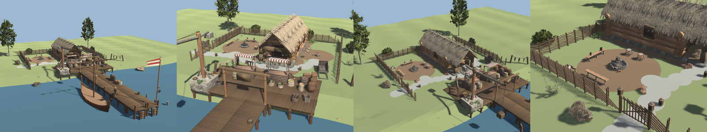
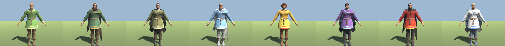
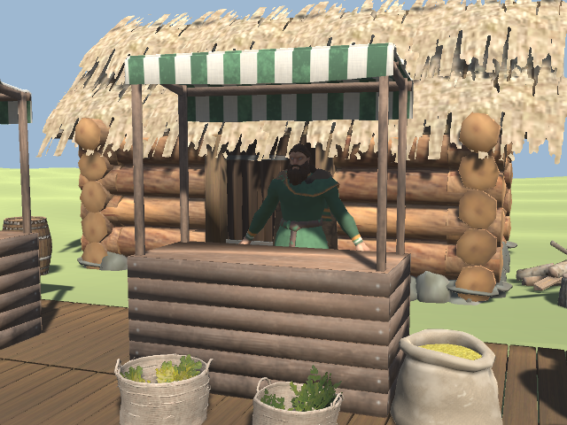

# ⚓ Trading posts

[← Back to the README](../README.MD)

Along the coasts of every biome stand **trading posts**: a long jetty out to deep water, a landing with two market stalls under awnings, a harbour crane and stock, the trader's small laft house and a fire with benches, all under a dome like the one over Haldor's camp. Sail there, tie up, walk up the jetty and trade. You can buy the land's materials there instead of searching for them for hours, sell goods from the next land over and every fish you catch, start an escort, and find the other posts on Hildir's charts.

## The posts

- **Where:** once per world, also in worlds made before, the server places up to **4 posts in each biome** that meets the sea, the Deep North included (`PerBiome`). A place is taken where the bank is low, the land behind the landing is flat, nothing rises along the jetty and the water at the jetty head is at least 2.5 m deep, with room for a ship alongside. Posts stand at least **1000 m** apart (`MinDistance`), **60 m** from anything players have built (`BuildingDistance`), clear of the world's locations and not near the world's centre.
- **Built to last:** the land behind the landing is levelled, and trees, rocks and bushes on the post are cleared. Its pieces cannot be broken, burnt or removed, and nothing can be built under the dome. Where the sea bed lies deeper than the jetty's piles reach, longer piles stand under them.
- **Safe:** the dome keeps monsters out, as Haldor's does, and covers the jetty and a ship alongside.
- **Seen from the sea:** a gate with a sign and lamps stands where the jetty meets the landing, and a flag and a lamp at its head. The stalls' awnings and the flag take the biome's colours.

## The traders

Behind the goods stall stands the post's trader, in the colours of the biome: **Asbjørn** in the Meadows, **Gunnar** in the Black Forest, **Ragnhild** in the Swamp, **Hallvard** in the Mountains, **Sigrid** on the Plains, **Ylva** in the Mistlands, **Brand** in the Ashlands and **Frøydis** in the Deep North. They turn to you as you come, wave and greet you, talk now and then, point, shrug or give a thumbs up, and wave you goodbye. Their clothes are dyed copies of the game's own and are not for sale.

## The store

Talk to the trader to open the store.

- **Buying:** a post sells the materials of its own biome once the world has slain the boss before it (the Meadows' at once, the Black Forest's after Eikthyr, and so on to the Deep North's after Fader). Before that the trader has nothing for you yet.
- **Selling:** a post buys the goods of the **next biome** over (the Meadows' post buys the Black Forest's goods, and the Deep North's buys the Meadows'), and **every fish** from anywhere, raw or cooked fish meat included. The sell button says what it sells and for how much, and the **»** button beside it steps to the next stack the post buys.
- **Prices:** a material's price is the biome's worth (Meadows 1, Black Forest 2, Swamp 3, Mountains 4, Plains 5, Mistlands 6, Ashlands 8, Deep North 10 coins) times half for bulk (wood, stone, grain, marble), twice for ore and metal and one and a half for hides. Bulk is sold 20 at a time, metal 5, the rest 10. A post pays **a quarter** of its own price (`BuyShare`), more with the [Trading skill](#the-trading-skill). A fish is worth four times its waters' worth, and half again for every star.
- **Unlimited goods:** the posts pay for goods even when they are unlimited in your chests (`BuyUnlimitedGoods`). Coins themselves are no longer unlimited in Linear mode (see [Restocking chests](chests.md#coins-and-valuables)).

| At a Meadows post | Coins |
|---|---|
| 20 Wood (buy) | 10 |
| 10 Deer Hide (buy) | 15 |
| 1 Copper Ore (sell) | 1 |
| 1 Perch (sell) | 1, 2 with three stars |
| 1 Northern Salmon (sell) | 10 |

## The Trading skill

**Trading** is a skill of its own. It rises with every trade at a post, buying and selling: one point per **5 coins** (`ExperiencePerCoins`), and with an escort's pay. As it grows:

- **Better paid:** a post pays you from **25 %** of its price at level 0 (`BuyShare`) to **40 %** at 100 (`MaxBuyShare`).
- **Cheaper:** what a post sells costs up to **10 % less** at 100 (`BuyDiscount`).
- **More gear:** every post also sells **gear of its own biome**: weapons, bows, armour and capes, shields and tools, at quality 1. Which gear belongs to which biome is found from the game's own recipes, by the latest material in each (the Bronze Sword is the Black Forest's, the Iron Sword the Swamp's), so new items from game updates come along; White Hilt's own gear is not sold. Each biome's gear is **shared out among its posts, every piece at one post only**, so to find it all you sail from post to post. A post's gear opens in four steps at Trading **20, 40, 60 and 80** (`UnlockLevels`), the cheapest first; what you have not opened is shown greyed out with the level it needs. The biome's boss still opens it, as for the materials.
- **Price of gear:** the materials of its recipe at the posts' prices, times **1.5** (`GearPriceFactor`). Refined metal counts as five pieces of its biome's worth (a Bronze bar 10 coins, Iron 15, Black Metal 25), so the Bronze Sword costs about 124 coins.
- **Known for:** a post is known for what most of its gear is (weapons, bows, armour, shields or tools). Looking at the trader shows it, and once you have opened the store the post's pin on your map says so too, e.g. *Trading post (bows)*; a post without a pin gets one.

The skill book (the skills dialog) shows your share, your discount and how many steps of gear are open to you.

## Escorts

Every post's trader sells the **Escort Contract** (300 coins, once Bonemass is slain). Use it at the post: a trading ship comes in beside the jetty, on the side away from your ship, and waits. Go aboard your own ship within 150 m of it and it sets out for **the nearest other trading post**, however far. Guard it against the Nail Ships on the way; when it reaches port with its cargo, every player near it gets **400 coins per kilometre** of the voyage for a full cargo. If you do not come aboard within 10 minutes it sails off and you get the contract back. See [Escorts](sea-battles.md#escorts) for the attacks, the cargo and the pay.

## Hildir's charts

Hildir sells a **Trading Post Chart** for each biome (150 coins), once the world has reached that biome. Read it and every trading post on that biome's coasts gets a pin on your map. The chart is kept, so you can read it again or give it to a friend.

## Console

| Command | Who | What it does |
|---|---|---|
| `whitehilt_tradepost here` | Admins | Builds a trading post where you stand, its jetty running out the way you look |
| `whitehilt_tradepost remove` | Admins | Removes the nearest trading post within 80 m, its trader too |
| `whitehilt_tradepost list` | Admins | Lists the posts with their biome and distance |
| `whitehilt_tradepost place` | Admins | Searches the coasts again and builds the posts each biome still lacks |

## Config

Settings in section `[TradingPosts]`, all the server's:

| Setting | Default | What it does |
|---|---|---|
| `Enabled` | true | Make trading posts. Off: no new ones are made, the posts already standing stay, and Haldor sells the Escort Contract again |
| `PerBiome` | 4 | Posts in each biome that meets the sea; 0 to 10 |
| `MinDistance` | 1000 | Least distance between two posts, in metres |
| `BuildingDistance` | 60 | Least distance from a new post to anything a player has built, in metres |
| `BuyShare` | 0.25 | Share of its own price a post pays for what it buys, at Trading 0 |
| `MaxBuyShare` | 0.4 | The share at Trading 100 |
| `BuyDiscount` | 0.1 | Share off what a post sells, at Trading 100 |
| `UnlockLevels` | 20,40,60,80 | Trading levels that open a post's gear, cheapest first; empty: all open |
| `GearPriceFactor` | 1.5 | A post's gear costs its recipe's materials times this |
| `ExperiencePerCoins` | 5 | Coins traded (or earned on an escort) per point of Trading; 0: the skill does not rise |
| `Prices` | empty | Prices that replace the built-in ones, in coins per piece: `Prefab:Price`, comma separated |
| `BuyUnlimitedGoods` | true | Pay for goods that are unlimited in the world's chests |
| `ChartPrice` | 150 | Coins a Trading Post Chart costs at Hildir. Needs a restart |

The escort settings `PayPerKilometre`, `WaitSeconds` and `StartRange` are in `[SeaBattles.Escorts]`, see [Sea battles](sea-battles.md#escorts). How the posts were made, picture by picture, is in the [plan](plans/trading-posts.md); the Trading skill in [its own](plans/trading-skill.md).
